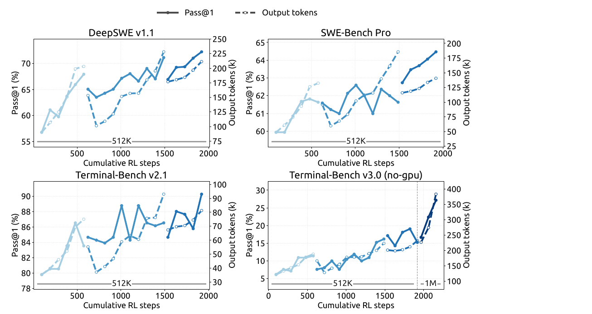
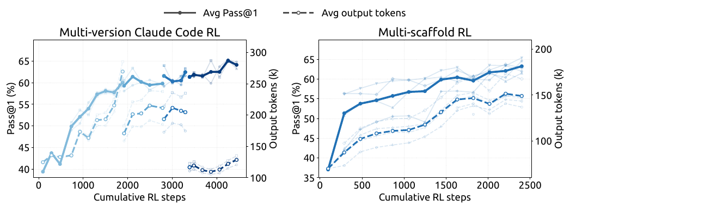
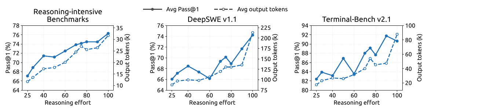
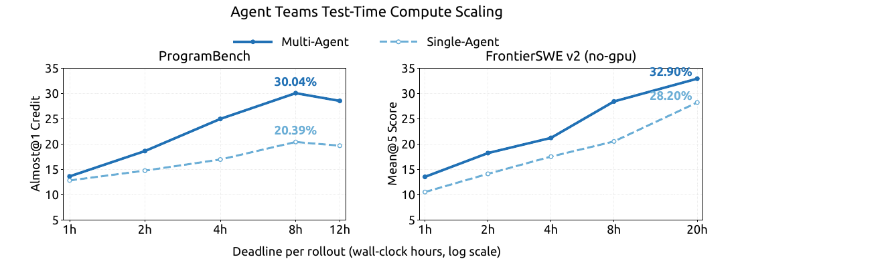

> 来源：用户提供的 `DeepSeek_V41_Tech_Report.pdf`，第 25–36 页，第 5 章全部内容（5.1–5.3.5）。[官方原文](https://huggingface.co/deepseek-ai/DeepSeek-V4.1-Flash/blob/main/DeepSeek_V41_Tech_Report.pdf)。
>
> 本文为中文翻译，非官方译本。保留原文章节、公式、图表编号和数据；图 7–10 直接从用户提供的 PDF 截取，英文图内标注保留，配中文图注。表 3 不复刻原文的最佳值加粗、次佳值下划线。正文中的“我们”均指原报告作者；作者的实验结论不代表独立验证。括号内作者—年份引用保留，完整参考文献及附录请见原报告。

## 5. 后训练

### 5.1. 后训练流程

这次发布沿用了成熟的后训练方法，没有引入新算法。整体流程仍然是先做监督微调（SFT），再做强化学习（RL）和在策略蒸馏（on-policy distillation，OPD；Gu et al., 2024; Lu and Lab, 2025）。我们把几乎全部精力都投入到训练内容上，重点建设能够大规模自动生成数据、搭建环境的流水线。

这条流水线主要做三件事：

1. 生成多样化、可验证的训练任务，同时准备参考解和奖励信号。
2. 用程序批量搭建可交互的 Agent 环境，让我们能以较低成本采集和评估执行轨迹。
3. 严格筛选和去重，并校准任务难度，保证数据质量，让训练任务的难度搭配更均衡。

我们发现，即使训练方法保持不变、采用的也是常规方法，只要系统地扩大数据和环境的规模、增加多样性、提高可验证性，就能获得几乎全部已观察到的性能提升。这也带来一个更普遍的判断：在当前阶段，继续投入工程力量改进数据和环境流水线，所获得的额外收益，显著高于探索新的后训练算法。

#### 5.1.1. 大规模 Agent 任务合成

Agent 需要通过任务来学习，而高质量训练任务过去往往依赖大量人工制作。我们观察到，模型已经开始能够为自己构建训练任务，虽然这项能力还很不成熟。看到这一潜力后，我们专门投入了大量精力，提高模型出题和验证任务质量的能力。

我们把每个任务定义为三个部分：**问题、环境、验证系统**。任务质量主要看两点：一是**难度**，任务需要有一定挑战；二是**正确性**，这三个部分及其相互配合不能存在关键缺陷。我们把难度和正确性作为奖励信号，反复训练模型，让它能构建更好的任务。

任务投入训练后，我们也会持续检查它的质量。每当它进入新一轮 RL 训练，模型产生的新轨迹都会成为重新审核任务的依据。按照这一思路，我们为通用 Agent 和编程 Agent 分别建立了训练环境生产流水线。

**通用 Agent。** 对于通用 Agent，我们鼓励内部员工和外部合作伙伴把最新模型用于日常工作，并自愿回传交互数据和反馈。根据回传数据中观察到的接口，我们构建了大量模拟工具，复现真实工具和系统的接口与行为，包括输入格式、输出结构、API 接口定义和行为约束，覆盖常见 SaaS、企业应用，以及更专业的业务后台系统。

与此同时，我们大量收集内部员工提交的负面反馈和模型失败案例，用它们生成贴近真实工作的单轮或多轮 Agent 环境。流水线会重建当时可用的工具、用户的交互方式，以及导致失败的条件。这样，我们就能反复重现这些失败，并通过强化学习针对性地改进模型的弱点。

**编程 Agent。** 编程 Agent 的训练环境来自两类来源：（1）内部员工和外部合作伙伴的编程 Agent 会话，经过筛选，保留高度复杂或模型表现不佳的任务，再按轨迹去重；（2）达到一定 star 数门槛的公开 GitHub 仓库。

环境由多个分工不同的 Agent 一起构建。首先，一个 Agent 检查项目能否在容器里构建、完整运行，并自动验证结果。确认可行后，它会选择某轮交互或某次代码提交作为任务起点，设计几个足够复杂的实现方向，再写出具体的验收点和环境搭建报告。需要时，它也会从网上获取外部资源。

验收点包括两类：**fail-to-pass**，要求原本失败的测试在修改后通过；**pass-to-pass**，要求原本通过的测试在修改后仍然通过。

接着，另一个 Agent 在隔离容器里安装依赖，准备初始工作目录、测试代码和任务说明。完成自测后，它会清除可能泄露解法的痕迹，再把环境打包为新的镜像层。

环境准备好后，多个不同的 Agent 会实际尝试解题。独立的质检 Agent 会结合环境和解题轨迹，检查环境故障、事实错误、验收点与题意不一致，以及评分规则被钻空子的可能性。

如果没有通过质检，修复 Agent 就处理所有已发现的问题，调整过于简单或过于困难的验收点，再把任务送回验证流程。

通过这些流水线，我们能够自动批量生产质量可靠、能区分模型能力，并且长度和难度可控的 RL 训练数据。通用 Agent 侧重重现真实工作流程，编程 Agent 侧重准确构建代码任务。两类环境最终都接入统一的训练系统，并在持续质检的基础上，帮助模型不断提高能力。

#### 5.1.2. 在合成任务中进行强化学习

我们让模型在合成任务中进行大规模异步 RL，以提升它处理复杂场景的能力，并调整它的行为方式。训练规模主要沿两个方向扩大：增加训练计算量，以及增加训练覆盖的 Agent 框架（scaffold）。如图 7 和图 8 所示，随着累计 RL 步数增加，无论只使用一个框架、同时使用同一框架的多个变体，还是混合使用不同框架，模型表现都在持续改善。



**图 7｜** 在 DeepSeek Harness 的 Minimal 模式下，随着 RL 训练规模扩大，多个编程 Agent 基准上的表现得到改善。进一步把最大上下文长度扩展至 100 万 token，可以继续提升模型在极长程任务上的表现，例如 Terminal-Bench v3.0。

> 图内标注译注：横轴为累计 RL 步数；实线对应左轴 Pass@1，虚线对应右轴输出 token 数，单位为千（k）；512K、1M 表示上下文长度。各子图分别为 DeepSWE v1.1、SWE-Bench Pro、Terminal-Bench v2.1 和 Terminal-Bench v3.0（无 GPU）。

为了让不同框架都能参与 RL 训练，我们把一次 rollout 的执行分成两部分：

- **Agent 沙箱**：运行 Agent 框架及其工具。
- **Worker 容器**：提供一套不依赖具体框架的控制层，协调执行，把不同框架产生的交互记录整理为统一的轨迹格式，并与训练器通信。

沙箱和 Worker 都运行在 DSec 上（见第 5.1.3 节），位于可被调度抢占的 GPU 训练资源池之外。这样，可能运行很久的 rollout 就能与频繁变化的训练资源调度分开管理。当训练器的资源被抢占时，系统可以暂停 rollout、卸载其运行状态并释放相关 CPU 和 GPU 资源，同时保留完整状态，以便之后恢复。通过这种设计，我们无需修改底层算法，就能稳定、高效地开展跨框架 RL 训练。

我们还希望把多轮 RL 的训练成果积累起来。做法是合并在不同框架或配置下训练得到的模型检查点，再以合并后的模型为起点，继续下一轮 RL。这样，不同训练路径带来的改进就能汇集到一起。

图 7 和图 8 中断开的曲线段，对应的就是模型重新初始化后的后续训练。这种做法进一步改善了任务表现和 token 使用效率，也提供了一种简单实用的方式，把并行开展的多轮 RL 成果合并起来，再继续扩大训练规模。



**图 8｜** 联合训练多个 Claude Code 版本（左图），以及跨异构框架训练（右图，包括 OpenCode、Pi，以及 DeepSeek Harness 的 Standard 和 PTC 模式）时，性能会随累计 RL 步数增加而改善。性能在 DeepSWE v1.1 上评估。浅色曲线表示各个框架版本或单个框架的评测结果。

> 图内标注译注：横轴为累计 RL 步数；实线对应平均 Pass@1，虚线对应平均输出 token 数；左标题为“多版本 Claude Code RL”，右标题为“多框架 RL”。

#### 5.1.3. 大规模运行 Agent：DSec

从 DeepSeek-V3 发展到 V4 的过程中，Agent 训练所需的环境越来越多，类型也越来越复杂。为此，我们建设了 **DeepSeek Elastic Compute（DSec）**，一个面向大规模 Agent 训练和评测的生产级沙箱平台。从最初设计时起，它就需要支持不同类型的执行环境、大规模镜像分发、多种隔离方式、高密度资源管理、命令执行记录，以及资源被抢占后的可靠恢复。

V4.1 的训练进一步将需求提升到数百万个并发沙箱实例，涵盖不同的 Harness、平台、代码仓库、软件依赖和任务专属服务。在这一规模下，主要瓶颈转向数据中心可扩展性、工作负载隔离、单节点计算密度，以及对日益强大的 Agent 不当行为的约束。下面简要介绍我们的关键设计。

**让更多机器共同承载沙箱。** DSec 主要通过两种互补方式扩大规模：把节点分组，以及放宽调度时的一致性要求。我们把大量计算节点分成多个分片，称为扩展单元（scale units）。不同实验的任务可以通过分片隔离，缩小故障的影响范围，避免一个大量占用内存的任务耗尽其他无关任务所需的资源。

DSec 使用自研的放置引擎，决定每个沙箱应该在哪台机器上运行，没有采用 Kubernetes 等现成编排器。为了支持更大的规模，这个引擎不要求所有调度副本随时掌握完全一致的全局状态。

这一设计基于一个观察：只要每台计算节点都能守住自身的安全限制，沙箱放置就只需要最终一致性。于是，我们部署了多个独立运行、无需同步协调的调度副本。每个副本根据近期测量结果估计还有多少可用资源，再作出足够合理的放置决定。

最后一道检查由接收任务的节点完成：如果接纳新沙箱会超过本地警戒阈值，节点就直接拒绝。这样，调度层可以放宽一致性要求，节点仍能避免过载；系统也就能扩展到数百万个容器，而不被中央协调拖慢。

**让单台机器承载更多沙箱。** 在每个节点内，我们利用硬件支持的子 NUMA 分区，把各个 Worker 虚拟机分别绑定到独立的 NUMA 域。容器运行在这些虚拟机中，只使用所在域的 CPU 和内存资源。

这种方式兼顾了较高的内存超额分配比例和 Linux 内核锁竞争问题，也把内存压力和运行故障限制在较小范围内。在可比的工作负载下，单个物理节点能够同时承载的存活容器数，从约 1,000 个提高到超过 2,500 个，之后才出现可测量的端到端性能下降。

不过，同一台机器上的任务太多时，后台任务可能干扰对耗时敏感的评测。为此，DSec 专门设置了延迟敏感（latency-sensitive，LS）任务类别。非 LS 任务使用 `SCHED_IDLE`，以最低调度优先级运行。同时，我们使用核心调度，确保同一物理核心的两个兄弟超线程只同时运行相同优先级类别的任务，避免不同类别之间的干扰。

**约束 Agent 的不当行为。** 在 RL 训练过程中，我们经常观察到 Agent 试图钻奖励机制的漏洞，或者无意中使环境崩溃。在一些尝试中，Agent 利用了近期披露的漏洞，包括 XFS 驱动的权限问题、AppArmor 的非法内存访问、从软件包镜像服务泄露答案等。Agent 还会删除关键二进制文件、破坏系统文件，甚至移除整个文件系统。我们使用每个沙箱独立的 AppArmor 配置，以及基于 eBPF 的细粒度网络策略，防止这些尝试。如果 Agent 导致自身环境崩溃，我们会把它视为失败轨迹，并向 RL 框架报告一个“后果”（repercussion）信号。

#### 5.1.4. RL 中可控的推理投入

除了模型架构和硬件，模型输出多少 token 也会直接影响服务成本。因此，要控制实际使用中的成本和质量，还需要能控制模型在推理上投入多少。我们在强化学习时引入一个数值 $b$，明确告诉模型本次需要多大的推理投入。这种机制同时用于单轮推理和多轮 Agent 任务。具体做法是在系统提示前加入以下指令：

```text
Reasoning Effort: {effort} (range 1–100; higher values request more thorough reasoning)
```

中文含义：推理投入为 `{effort}`，范围 1–100；数值越高，要求推理越充分。

这里，$b\in\{1,\ldots,100\}$ 表示所请求的投入等级。对于每个训练提示 $x$，我们在每个投入等级 $b\in\mathcal B$ 下采样 $M_b$ 个回答：

$$
z_{b,j}\sim\pi_\theta(\cdot\mid x,b),\qquad b\in\mathcal B,\quad j=1,\ldots,M_b. \tag{8}
$$

其中，$j$ 表示在投入等级 $b$ 下生成的第几个回答。对于同一道题、同一个投入等级，也就是相同的 $(x,b)$，我们把这些回答归为一个子组。计算优势时，每个回答的奖励都减去本组的平均奖励，以衡量它相对于同组其他回答的表现。

不同投入等级的回答不会直接互相比较。为了让模型学会按投入等级调整行为，我们让长度惩罚随 $b$ 变化。具体来说，在回答 $z_{b,j}$ 的奖励中加入以下长度惩罚：

$$
r^{\mathrm{len}}_{b,j}=-\min\left\{C_{\max},\;k(b)\frac{\ell_{b,j}}{L_{\mathrm{norm}}}\right\}. \tag{9}
$$

其中，$\ell_{b,j}$ 是推理 token 数，$L_{\mathrm{norm}}$ 是参考长度，$C_{\max}$ 限制每条轨迹的最大扣分。token 惩罚系数随所请求的投入等级呈指数下降：

$$
k(b)=k_0\exp\left(-\frac{b-b_{\min}}{\tau}\right),\qquad \tau=\lambda\Delta b. \tag{10}
$$

其中，$k_0$ 是各投入等级所使用的基础惩罚系数，$b_{\min}$ 是 $\mathcal B$ 中的最小值，$\Delta b$ 是训练投入等级之间的平均间距，$\lambda$ 控制惩罚衰减速度。每当 $b$ 增加 $\tau$，惩罚系数就乘以 $e^{-1}$。参数 $k_0$ 控制促使推理变短的总体压力；较小的 $\tau$ 则使惩罚衰减更快，通常会让不同投入等级之间的行为差异更明显。附录 C 从边际效用的角度解释了 $k(b)$ 采用指数参数化形式的动机。

部署后，只要调整 $b$，就能灵活控制同一个模型的推理投入，在模型已学会的成本与质量之间作出选择，以满足不同的延迟、token 预算和解答质量要求。虽然训练只用了有限几个投入等级，实际使用时仍可选择它们之间的数值，让模型表现出介于相邻等级之间的推理行为。这样，推理时的资源投入就能调得更细。

在 2026 年 9 月上线的服务中，公开 API 提供 max、high 和 low 三个预设档位。如表 2 所示，它们分别对应 $b=100$、$b=75$ 和 $b=50$。用户只需选择档位，就能调整成本与质量的取舍，无需改动模型权重或解码配置。

**表 2｜公开 API 推理投入档位与底层标量投入值 $b$ 的映射。**

| API 档位 | 投入值 $b$ |
|---|---:|
| max | 100 |
| high | 75 |
| low | 50 |

### 5.2. 异步后训练基础设施

在 LLM 强化学习中，少数样本生成得特别慢，经常拖住整个 rollout 阶段，这就是长尾问题，也是训练效率的主要瓶颈之一。为此，我们改进了后训练基础设施，让样本能够异步生成（Zeng et al., 2026; Team et al., 2026b）。系统持续保持足够多的样本同时生成，从而显著减轻慢样本带来的影响。目前，几乎所有 RL 和 OPD 任务都已启用异步训练，rollout 效率明显提高。

#### 5.2.1. 整体工作流程

rollout 和训练共用同一批物理设备，轮流使用这些设备。这样，我们就不必手动决定两个阶段各分配多少资源。每个任务设定一个在途样本上限，也就是最多允许多少个样本同时处于生成过程中；系统在 rollout 阶段按这一并发上限调度。

为了保持目标并发量，我们比较了三种补充新任务的方式，最终选择了**样本级派发**：只要新完成的样本数凑够下一个提示所需的 GRPO 组大小，就派发这个提示，让它开始生成一组回答。已经完成的样本可以来自不同组，不必等某一整组全部完成。这样，rollout 并发量就能保持得更稳定。

在此之前，我们试过另外两种方式。第一种是在开始时多派发几个批次，每轮训练结束后再补一整批。结果训练指标大幅波动，说明每次以整批为单位调整，步子太大。第二种是等某个提示对应的整个 GRPO 组完成后，再补一个新提示。但只要组内有一个样本特别慢，补充新任务就会被拖住，并发量也难以维持稳定。

收集到足够多的样本后，系统会暂停正在进行的 rollout，把设备切换到训练阶段。训练时，我们采用**拼接式路由重放（concatenated routing-replay）**：如果一个样本的不同片段由不同版本的模型生成，就把各片段原先记录的专家路由拼接起来使用，保留当时选择专家的结果，不再用新模型重新计算整条样本的路由。

#### 5.2.2. 缓解长度偏差与离策略影响

异步生成提高了效率，也带来了两个需要处理的问题：

- **短样本更容易先进入训练。** 短回答通常先生成完，尤其在训练刚开始时，它们在训练批次中的占比可能过高，造成长度分布偏差。
- **部分样本来自旧模型。** 样本的一部分甚至全部 token，可能由较早版本的模型生成。这类样本称为离策略（off-policy）样本。

这两个问题会影响训练质量，需要分别处理。

针对长度偏差，我们采用两种办法。首先，分别限制各个数据集的并发量，调节系统稳定运行后各数据集进入训练的比例。通过控制样本来源，可以间接调整长短样本的比例。其次，允许丢弃一部分早早完成的短样本，让训练初期的长度分布逐渐接近稳定状态，避免模型过度适应短回答。

针对旧模型生成的样本，我们也采用两种办法。首先，调整何时派发新样本、何时开始训练，把离策略样本的比例控制在上限以内，避免训练数据与当前模型相差太大。其次，在计算训练损失时，用掩码屏蔽过于陈旧的 token，让它们不再影响梯度更新。

#### 5.2.3. 性能优化

在异步 RL 中，系统需要定期中断 rollout，切换到更新后的模型。我们希望切换尽可能顺畅：接到指令后几乎立即停止，恢复后从原位置接着生成。

为了及时停止 rollout，我们支持 **token 级中断**：可以在任意 token 边界停止生成。一旦收集到足够的训练数据，所有在途样本几乎立即停止，使系统能够毫无延迟地进入训练阶段。

为了在模型切换时保留生成进度，系统会逐 token 保存 KV 缓存、专家路由等状态。切换到新模型后，直接复用这些状态，无需重新对已有上下文做预填充计算，中断的样本就能接着往下生成。由于所有尚未完成的样本都需要保存状态，我们会在每个样本完成后，立即回收它占用的状态资源。

除了检查点切换，同样的快速中断与无缝恢复机制，也使训练作业能够及时响应集群调度的抢占信号而不丢失进度，从而提高整体集群利用率。

#### 5.2.4. 大规模在策略蒸馏

后训练的最后一步是全词表 OPD。我们使用覆盖所有领域的数据集，以及超过 40 个教师模型，并通过异步生成提高 rollout 效率。

不同领域的训练过程各不相同，因此，最适合某个领域的教师模型，可能来自模型开发的不同阶段。教师之间、教师与学生之间，也可能采用不同架构。我们的基础设施支持这种组合，能够让大量不同架构的教师参与全词表 OPD，教师数量实际上不受限制，切换教师的开销也几乎可以忽略（DeepSeek-AI, 2026b）。

OPD 训练过程中还需要调整配置。我们持续观察模型能力，再按需要改变数据集配比、各数据集的并发上限，以及当前使用的教师模型。

同步训练可以在一个 rollout 批次结束后切换配置，边界很清楚。异步训练则更复杂：按旧配置和新配置生成的样本，可能同时还在运行。我们的基础设施能够处理这种情况，在不中断 rollout 或训练的前提下，保证配置切换前后衔接一致。

### 5.3. 评测

#### 5.3.1. 评测设置

我们的后训练评测主要关注推理和 Agent 能力；知识密集型任务的表现主要由预训练决定，已在表 1 中报告。对于推理能力，我们评估 GPQA Diamond（Rein et al., 2023）、Humanity’s Last Exam（Phan et al., 2025）、Codeforces（内部基准）以及 MathArena Apex（Dekoninck et al., 2025），temperature 和 top-p 均设为 1.0。对于 Agent 能力，我们评估以下四类任务：

- **编程 Agent：** Terminal-Bench 2.1（Merrill et al., 2026）、Terminal-Bench 3.0（Marten et al., 2026b）、Terminal-Bench 4.0（Marten et al., 2026a）、DeepSWE v1.1（DataCurve, 2026）、ProgramBench（Yang et al., 2026）、NL2Repo-Bench（Ding et al., 2025）。
- **网络安全：** SEC-Bench Pro 的 260505 版本（Lee et al., 2026）、CyberGym（Wang et al., 2026c）和 ExploitGym（Wang et al., 2026b）。
- **通用 Agent：** AutomationBench v1.0.6 的公开评测集（Shepard and Salimans, 2026）、Agents’ Last Exam（Sun et al., 2026a）（ALE-CLI）。
- **视觉 Agent：** Chartography（Garre et al., 2026）、BabyVision（Chen et al., 2026）、ZeroBench 主集（Roberts et al., 2025）。

在编程 Agent 评测中，我们使用 DeepSeek Harness 的 Minimal 模式评估 DeepSeek-V4.1-Flash，上下文窗口为 100 万 token，temperature 为 1.0，top-p 为 0.95。为了遵循官方设置要求，DeepSWE v1.1 使用 mini-SWE Harness。SEC-Bench Pro 则使用 Claude Code Harness，主要是为了使用它的会话压缩机制。对于视觉 Agent 任务，我们使用 Claude Code Harness，上下文窗口为 512k token，temperature 为 1.0，top-p 为 0.95。Agents’ Last Exam 和 AutomationBench 使用各自的官方框架进行评测。模型在其他编程框架下的表现见表 4。

为了减少编程 Agent 评测中的钻奖励规则空子的行为，我们限制互联网访问，并从环境中移除 Git 历史。此外，我们自动清理各种环境中的临时构建缓存和包缓存，包括 Go 模块缓存（go/mod）、node modules 依赖产物、编译后的 `.jar` 文件，以及 Python 的 pycache 目录。尽管采取了这些措施，测试中仍观察到寻找漏洞的行为，例如反编译 Ubuntu Linux 核心软件包，以发现 CyberGym 中的漏洞。随着模型能力增强，标准评测基础设施（例如 Docker 容器和验证脚本）更容易被模型钻空子。我们呼吁更广泛的研究社区，在设计下一代基准时优先考虑检测并缓解这些行为。

#### 5.3.2. 评测结果

**表 3｜DeepSeek-V4.1-Flash 与闭源／开源模型的比较。** † 表示 HLE 的纯文本子集。所有模型列均为 Max 档位；为便于阅读，拆为推理与 Agent 两张表。原表的粗体和下划线排名样式未复刻，数值保留。

| 推理基准（指标） | Opus-5 | GPT-5.6 Sol | K3 | GLM-5.3 | DS-V4-Pro | DS-V4-Flash | DS-V4.1-Flash |
|---|---:|---:|---:|---:|---:|---:|---:|
| GPQA Diamond（Pass@1） | 93.4 | 94.1 | 92.9 | 88.1 | 92.4 | 89.9 | 90.9 |
| HLE（Pass@1） | 56.3 | 44.5 | 43.5 | 42.0† | 42.7† | 37.8† | 36.8（39.1†） |
| Codeforces（Rating） | - | - | - | - | 3348 | 3289 | 3471 |
| MathArena Apex（Pass@1） | - | - | 65.6 | - | 65.3 | 58.6 | 65.6 |

| Agent 基准（指标） | Opus-5 | GPT-5.6 Sol | K3 | GLM-5.3 | DS-V4-Pro | DS-V4-Flash | DS-V4.1-Flash |
|---|---:|---:|---:|---:|---:|---:|---:|
| Terminal-Bench 2.1（Pass@1） | 89.1 | 88.8 | 88.3 | 88.2 | 87.9 | 82.7 | 90.6 |
| Terminal-Bench 3.0（Pass@1） | 43.3 | 34.4 | 17.7 | 28.3 | 11.8 | 7.6 | 30.0 |
| Terminal-Bench 4.0（Pass@1） | 51.8 | 39.9 | 12.6 | 37.9 | 12.4 | 7.0 | 31.2 |
| DeepSWE v1.1（Resolved） | 74.0 | 73.0 | 67.5 | 66.9 | 62.7 | 54.4 | 74.2 |
| ProgramBench（Almost@1） | 37.0 | 23.0 | 17.5 | 19.0 | 15.5 | - | 20.3 |
| NL2Repo-Bench（Score） | 75.3 | 56.8 | 58.0 | 58.0 | 61.5 | 54.2 | 65.4 |
| CyberGym（Pass@1） | - | 84.5 | 80.0 | 84.5 | 83.3 | 76.7 | 88.1 |
| SEC-Bench Pro（Pass@1） | - | 74.3 | - | - | 56.4 | 30.9 | 62.8 |
| ExploitGym（Pass@1） | 22.1 | 33.7 | - | 15.0 | 5.4 | 1.8 | 15.3 |
| HLE，使用工具（Pass@1） | 63.6 | - | 59.8 | 62.5 | 60.0 | 51.5 | 63.9 |
| Automation-Bench（Pass@1） | 50.3 | 45.8 | 46.7 | 48.8 | 43.2 | 37.7 | 54.8 |
| Agents’ Last Exam（Pass@1） | 28.6 | 26.7 | 27.6 | 28.5 | 25.7 | 25.2 | 31.8 |
| Chartography，使用工具（Pass@1） | 84.0 | 79.9 | 68.1 | - | - | - | 78.9 |
| BabyVision，使用工具（Pass@1） | 94.1 | 88.9 | 85.7 | - | - | - | 89.6 |
| ZeroBench-main，使用工具（Pass@5） | 52.0 | 53.0 | 41.0 | - | - | - | 49.0 |

如表 3 所详述，与前代 DeepSeek-V4-Flash 相比，DeepSeek-V4.1-Flash 在推理和 Agent 基准上均有显著提升，同时达到或超过顶级开源和专有模型的表现。

在核心推理任务上，DeepSeek-V4.1-Flash 的 Codeforces rating 达到 3471，超过 DeepSeek-V4-Flash 的 3289 和 DeepSeek-V4-Pro 的 3348。在 MathArena Apex 上，它取得 65.6% 的 Pass@1 准确率，与表现最好的开源基线 Kimi-K3（65.6%）以及 DeepSeek-V4-Pro（65.3%）处于相当水平。此外，它的 GPQA Diamond 得分达到 90.9%，相较 DeepSeek-V4-Flash 的 89.9% 稳步提升。

Agent 任务上的增益更为明显。特别是在 DeepSWE v1.1 上，DeepSeek-V4.1-Flash 达到 74.2% 的通过率，显著高于 DeepSeek-V4-Flash 的 54.4%，并超过 Opus-5（74.0%）和 GPT-5.6 Sol（73.0%）等领先专有模型。在 Terminal-Bench 2.1 上，它取得 90.6%，超过 Opus-5（89.1%）和 GLM-5.3（88.2%）。同样，在 Automation-Bench（54.8%）和 Agents’ Last Exam（31.8%）上，它取得领先于开源同类模型和顶级闭源系统的分数。尽管模型较为紧凑，DeepSeek-V4.1-Flash 仍展现出最先进水平的 Agent 能力，大幅缩小了与前沿闭源模型的差距，同时在开源模型中建立了明显优势。

在网络安全任务上，DeepSeek-V4.1-Flash 在开源模型中取得了新的最佳水平。鉴于这些能力既可能用于防御，也可能用于攻击，我们鼓励社区负责任地应用这些能力，例如用于防御性安全研究和漏洞修复。在视觉 Agent 任务领域，DeepSeek-V4.1-Flash 展现出稳健能力，尤其擅长需要视觉推理和复杂专业图表分析的场景。虽然它超过了领先开源模型 Kimi-K3，但我们承认，与领先闭源模型相比，仍存在可测量的差距。

除了峰值性能，DeepSeek-V4.1-Flash 还提供推理投入设置，使用户能调整推理成本与准确率之间的取舍。如图 9 所示，在推理与 Agent 基准上，准确率和输出长度都会随投入等级稳步增加。把投入等级从 25 提升到 100，会使八个推理密集型基准的平均 Pass@1 从 67.1% 提升到 76.3%，DeepSWE v1.1 从 66.0% 提升到 74.2%，Terminal-Bench 2.1 从 82.4% 提升到 90.6%，代价是输出 token 数约变为 2.5 倍。

值得注意的是，在单次回答推理中学到的投入控制，也能用于需要长时间执行的 Agent 任务，控制多轮交互中探索和验证的总量。增益主要集中在前段：60–80 的投入区间已能以不到最高档一半的 token 预算，获得接近最高档的准确率；而最后提升到 100，则使 Agent 轨迹长度增加至 1.6–1.8 倍，准确率却只略有提高。因此，最高档最好留给最具挑战的任务，中等投入等级则更适合日常 Agent 使用，能够取得良好的成本—性能平衡。

#### 5.3.3. 不同推理投入下的表现

图 9 报告了一系列预算值下的性能和平均回答长度。随着推理投入增加，模型生成的推理轨迹逐渐变长，在推理密集型基准和软件工程任务上的准确率单调提高；最大增益集中于低到中等预算区间，之后收益递减。尽管我们的 RL 只涉及有限个投入等级，标量投入仍能在一定范围内对回答长度进行灵活的插值控制。

这使实践者能够沿平滑连续的范围，在质量、延迟和 token 成本之间进行权衡：延迟敏感型应用可采用低投入，只付出适度的准确率损失；困难任务则可以采用高投入，发挥模型完整的推理能力。在公开 API 服务中，我们提供映射到这一尺度的三个预设等级：low、high 和 max 分别对应 50、75 和 100。



**图 9｜** 性能和输出长度随推理投入的变化。每个子图展示投入值从 25 变化到 100 时的 Pass@1（实线，左轴），以及每个回答的平均输出 token 数（虚线，右轴）。推理密集型基准结果取八个基准的平均值：AIME 2026、Apex 2025 Shortlist、GPQA Diamond、HLE、IMO-AnswerBench、LiveCodeBench、MathArena-Apex、SimpleQA-Verified。DeepSWE v1.1 使用 mini-SWE 评测，Terminal-Bench v2.1 使用 DeepSeek Harness（Minimal）评测。

> 图内标注译注：横轴“Reasoning effort”为推理投入；“Avg Pass@1”为平均 Pass@1；“Avg output tokens”为平均输出 token 数；“Output tokens (k)”为输出 token 数（千）。

#### 5.3.4. 不同 Agent 框架下的表现

实际使用时，同一个模型往往会接入不同的 Agent 框架。这些框架的系统提示、工具定义、上下文管理和交互方式都可能不同。如果模型过度适应了某个 Harness，换一个框架后，表现就可能明显下降。

为了评估模型对这类变化的稳健性，我们的比较覆盖六个类框架的八种配置：Claude Code（Anthropic, 2026）、Codex（OpenAI, 2026）、OpenCode（Anomaly, 2026）、Pi（Zechner, 2026）、mini-SWE（Yang et al., 2024），以及 DeepSeek Harness（DSH）（DeepSeek-AI, 2026a）的 Minimal、Standard 和 PTC 模式。对每个框架，我们保持模型检查点、解码配置和任务集完全相同，只改变外围 Harness，包括其原生系统提示、工具接口定义和轮次交互逻辑。表 4 报告了最高推理投入（100）下，在 DeepSWE v1.1 和 Terminal-Bench v2.1 上的表现。

模型的 Agent 能力能够良好迁移到具有不同提示和工具接口的类框架，而不依赖特定 Harness 的约定。即使外围交互协议和工具抽象发生变化，性能仍然稳健，表明模型的 Agent 行为并未与单一框架设计紧密绑定。这一稳健性与合成训练数据（第 5 节）中环境、工具接口定义和交互格式的多样性相一致；这些数据的设计目标正是促进跨 Agent 框架的泛化。

**表 4｜最高推理投入下，不同 Agent 框架的表现。**

| 基准（指标） | Claude Code | Codex | OpenCode | Pi | mini-SWE | DSH Minimal | DSH Standard | DSH PTC |
|---|---:|---:|---:|---:|---:|---:|---:|---:|
| DeepSWE v1.1（Resolved） | 69.8 | 65.6 | 65.5 | 66.2 | 74.2 | 72.6 | 70.5 | 67.6 |
| Terminal-Bench v2.1（Pass@1） | 88.0 | 84.1 | 85.0 | 86.1 | 90.3 | 90.6 | 85.8 | 85.8 |

注：所有框架在 DeepSWE v1.1 上每题采样 $N=8$ 次，在 Terminal-Bench v2.1 上每题采样 $N=3$ 次。两项基准均使用 Linux 容器，temperature 为 1.0，top-p 为 0.95，上下文窗口为 100 万 token，每个 Agent 的模型生成轮数上限为 `max_steps=500`。Terminal-Bench v2.1 评测不允许网络访问。我们评估了四个 Claude Code 版本，各版本结果及其平均值见附录表 5；本表报告的是 v2.1.251。更多框架专属配置见附录 B.1。

#### 5.3.5. 多 Agent

为了探索多 Agent 在复杂任务上的协作，我们使用 DeepSeek Harness 的 Agent Team 模式，对 DeepSeek-V4.1-Flash 开展了初步实验。

**多 Agent Harness。** 我们使用 DeepSeek Harness 的 Agent Team 模式，主 Agent 默认可以通过 `spawn_teammate` 异步创建有名称、可持续存在的队友。每个队友接收委派任务，并以两种模式之一启动：fresh 模式不包含主 Agent 历史；fork 模式获得主 Agent 已完成轮次的一次性快照。所有 Agent 共享同一个仓库检出目录，因此修改会立即彼此可见。

Agent 通过能够持久保存消息的邮箱互相通信。通过 `send_message` 发送的消息，会在正在运行的队友完成当前步骤后送达；对于空闲队友，会启动新一轮执行；对于非活跃队友，则会恢复其执行。在每个队友任务的整个生命周期内，主 Agent 使用 `list_agents` 监测运行状态，并通过 `wait_agent` 等待状态、邮箱或共享任务发生变化。任务归属、依赖关系和建议各自修改的文件范围，维护在共享任务看板上，使用四个 `team_task_*` 工具，并在更新时检查修订版本。

需要干预时，只有主 Agent 可以通过 `interrupt_agent` 中断队友当前轮次。所有必要工作完成后，主 Agent 审核并测试合并后的修改，给出最终回复。

**训练。** 我们使用一种组合式 RL 奖励训练 Agent Team 模式，奖励由任务表现、鼓励委派与 Agent 间通信的协作奖励，以及促进高效协调的根据执行过程估算的延迟惩罚组成。这种延迟的计算方式是：将执行事件及其协作依赖表示为有向无环图（DAG），按固定的预填充和解码速率，把 token 数换算为耗时，再加上实测工具执行时间，最后计算关键路径的总耗时。这会鼓励有用的并行，同时惩罚不必要的串行工作和同步，并降低对服务端批处理和排队延迟的敏感性。

**性能。** 我们构建了 ProgramBench（Yang et al., 2026）的高置信度子集，只保留参考解在隐藏测试集上通过率至少为 95% 的任务。筛选后留下 172 个“黄金”任务。我们还评估了 FrontierSWE v2（Kondra et al., 2026），它是 FrontierSWE 规模更大、难度更高的后继版本，并采用了显著改进的方法。我们从当前公开任务中排除需要 GPU 的任务，构建无 GPU 子集。

在两个基准上，我们都为每次 rollout 设定明确的实际时间截止期限，比较单 Agent 和多 Agent 配置。这里报告的结果是初步结果：我们比较观察到的最强多 Agent 配置与当前可用的最强单 Agent 基线。在 ProgramBench 上，每题最多运行三次 rollout，即每种配置计划进行 516 次 rollout。我们报告 Almost@1，即得分至少达到 0.95 的单次 rollout 所占比例。对于 FrontierSWE v2，我们报告 Mean@5。ProgramBench 的截止期限从 1 小时到 12 小时不等，FrontierSWE v2 从 1 小时到 20 小时不等。每个截止时间点的指标，均依据该时间点已获得的输出计算。



**图 10｜** 在 ProgramBench（Almost@1）与 FrontierSWE v2（Mean@5）上，单 Agent 和多 Agent 配置的测试时计算扩展表现，横轴为每次 rollout 的实际时间截止期限。

> 图内标注译注：“Multi-Agent”为多 Agent，“Single-Agent”为单 Agent；横轴时间单位为小时，采用对数刻度；右图为 FrontierSWE v2 的无 GPU 子集。

如图 10 所示，在两个基准的所有截止时间点，多 Agent 配置都优于对应的单 Agent 配置。在 ProgramBench 上，多 Agent 的 Almost@1 从 1 小时的 13.59% 上升到 8 小时的峰值 30.04%，单 Agent 对应为 12.79% 和 20.39%。在 FrontierSWE v2 上，多 Agent 的 Mean@5 从 1 小时的 13.50% 提升到 20 小时的 32.90%，单 Agent 则从 10.50% 提升到 28.20%。

---

译文范围到此结束。原报告下一章为第 6 章「结论、局限性与未来方向」，不在本次翻译范围内。
