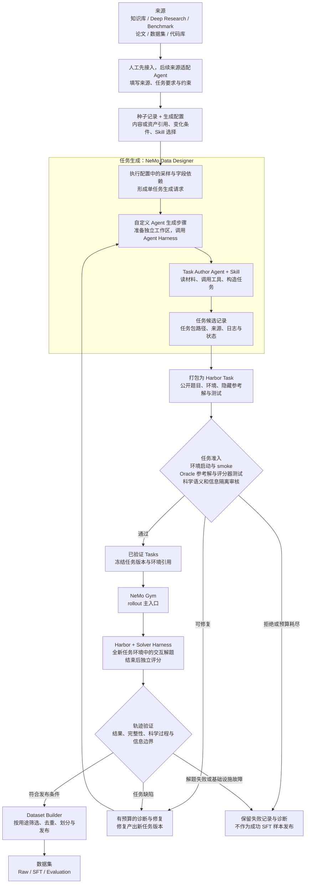
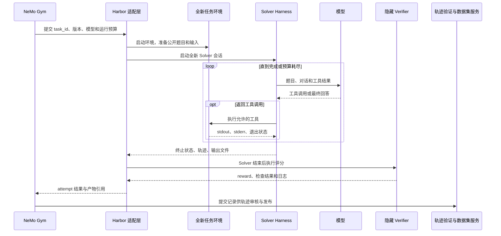

# 第十三章 技术选型：Data Designer 任务生成与 Gym / Harbor Rollout

> 决策日期：2026-09-15  
> 状态：下一版技术选型已确认；尚未完成本项目集成与端到端验证  
> 上级索引：[科学任务与轨迹数据生成设计](../scientific-data-generation-design.md)

## 1. 选型结论

采用 **NeMo Data Designer 组织任务生成，NeMo Gym + Harbor 承接 rollout**。人或 Agent 准备来源与生成要求，Task Author Agent 根据 Skill 构造任务；项目侧保留任务准入、科学语义审核、产物追溯与数据集发布逻辑。

平台需要承接来自知识库、Deep Research、Benchmark、论文、数据集和代码库等不同来源的任务生产流程。输入先整理成约定的种子记录，再由可配置的生成逻辑处理。第一步先由人工准备输入与配置，跑通 Data Designer；来源适配 Agent 后续接入。

这是下一版目标架构。第十至十二章及实验报告保留已有实现与运行证据；本文不表示现有 Controller 已经迁移，也不表示任意 Harbor / Gym 版本或执行后端已在本项目中验证兼容。

## 2. 组件职责与输入输出

| 组件 | 输入 | 负责什么 | 输出 |
| --- | --- | --- | --- |
| 人 / 来源适配 Agent | 知识库结果、研究报告、Benchmark、论文、数据、仓库 | 整理来源内容或可读取引用、任务要求、约束和生成配置选择 | 种子记录与生成请求 |
| NeMo Data Designer | 种子记录、生成配置、组件引用 | 组织采样、字段依赖、模型生成、自定义处理与验证步骤 | 结构化任务候选记录 |
| Agent 生成适配器 | 当前记录、选定 Skill、模型与运行设置 | 准备工作区，启动有工具能力的 Author Agent，收集产物、日志与失败状态 | 任务包引用、构造记录、状态 |
| Task Author Agent + Skill | 论文、数据、代码库、生成要求 | 理解材料，运行工具，构造题目、输入、环境、参考解与评分器 | 候选任务包 |
| 任务打包与准入服务 | 候选任务包、验证策略、来源证据 | 转换为 Harbor 格式；执行环境、参考解和评分器测试；组织语义审核 | 已验证 Task 或失败报告 |
| NeMo Gym | 已验证 Tasks、模型与 Harness 配置 | 作为 rollout 主入口，组织批量模型与 Agent 运行，并提供后续评测、训练接入点 | 运行状态与结果引用 |
| Harbor + Agent Harness | 单个 Task、运行配置 | Harbor 管理任务环境与验证执行；Terminus-2 等 Harness 驱动模型和工具交互 | 轨迹、输出 artifacts、评分与运行日志 |
| 项目侧轨迹验证与 Dataset Builder | 执行结果、任务和来源记录 | 检查轨迹完整性、科学过程与信息边界；筛选、去重、划分和序列化 | Raw / SFT / 评测数据与发布清单 |

NeMo Gym 与 Harbor 已有上游集成；初始接入优先评估该适配路径，Harness 候选为 Terminus-2。具体版本、模型协议、存储和容器后端在集成 smoke 中确定并锁定。[Gym 官方说明](https://github.com/NVIDIA-NeMo/Gym)、[Harbor Agent 配置](https://github.com/NVIDIA-NeMo/Gym/blob/main/responses_api_agents/harbor_agent/configs/harbor_agent.yaml)

## 3. 整体生产流程



失败按原因分类。基础设施故障与解题失败分开统计；预算内可发起新的独立 attempt。修复任务必须生成新版本并重新准入。评测保留成功与失败，SFT 默认只收录通过验证的成功轨迹；不能将反复重试后的成功比例当成模型首次成功率。

## 4. 输入合同与生成逻辑

### 4.1 人或 Agent 填什么

输入允许是原始材料内容或可访问的资产引用，不要求人工先整理出所有任务字段。建议种子记录包含：

| 字段 | 示例含义 |
| --- | --- |
| `source_id` | 来源组合的稳定 ID |
| `paper` | 论文文本或本地文件引用 |
| `data` | 数据文件、用途、版本或哈希 |
| `repository` | 仓库地址、固定 commit、准备后的路径 |
| `generation_request` | 希望生成的任务类型、变化条件和约束 |
| `workflow_ref` | 选用的 Data Designer 生成配置版本 |
| `authoring_skill_ref` | Author Agent 使用的 Skill 版本 |

以上为项目拟定字段，不是 Data Designer 的内置 schema。材料引用由读取器或适配器解析；代码仓库和文件不能仅靠路径字符串自动进入普通 LLM 的上下文。Benchmark 的公开题目可指导生成方向，隐藏答案、测试和原始评测实例不得作为新任务来源。

### 4.2 两类 Recipe 的区别

- **Scientific Recipe**：描述来源支持的科学方法与任务族，是 Author / Reviewer 的知识资产。
- **生成配置（workflow）**：描述 Data Designer 的字段、采样、Prompt、依赖和自定义步骤。可以由人编写，后续由 Agent 选择或修改。

日常填表主要改变种子内容和生成请求；遇到新任务形态时，才需要新增或调整生成配置、Skill 与验证组件。

### 4.3 自定义 Agent 步骤

适配器建议提供如下概念接口，具体 schema 在实现时冻结：

```text
generate_task(seed_record, generation_request, skill_ref, execution_config)
    -> task_id
       candidate_package_uri
       artifact_digest
       authoring_trace_uri
       status
       error_category
```

Data Designer 可以组织自定义生成逻辑，验证也可以接入自定义函数或 HTTP 服务。Agent 的工具循环、容器、超时、产物存储和恢复由适配器及执行后端实现；不能把 Skill 文本拼进普通生成列就视为拥有工具能力的 Agent。[自定义列接口参考](https://nvidia-nemo.github.io/DataDesigner/0.5.4/code_reference/column_configs/)、[验证器](https://docs.nvidia.com/nemo/datadesigner/concepts/validators)

第一版采用“一条生成请求对应一个任务候选”。一个来源要生成多个任务时，先展开不同生成请求；生成后检查内容重复。大文件、任务目录和轨迹存于文件或对象存储，记录中保存 URI 与哈希。

## 5. Rollout 控制与执行流程

**NeMo Gym 是 rollout 主入口，Harbor 是任务执行适配路径，具体 Harness 驱动单次解题循环。** Data Designer 不驱动正式 Solver 的逐轮工具调用。



### 5.1 调度归属

- 项目 Controller 管理生成、任务准入、修复和发布的阶段状态，不另外启动一套与 Gym 竞争的 Solver 调度循环。
- Gym 作为 rollout 请求与批次状态入口，通过选定集成路径调用 Harbor。
- Harbor 的执行并发与超时通过适配层显式配置；具体预算只由一个责任方控制，避免 Gym 与 Harbor 重复重试。
- 每个 attempt 使用独立 ID，关联任务版本、环境、模型和 Harness 配置。具体取消、重试与恢复接口必须在集成阶段验证。

### 5.2 Solver 信息边界

正式 Solver 只获得公开题目、输入、输出合同、执行设置、允许工具与任务环境。**不接收 Campaign、Recipe、Scientific Skills、参考解、评分器、历史失败轨迹或 Reviewer 反馈。**

Oracle 准入检查与正式 Solver 使用不同的全新运行实例，不能复用参考解执行后的文件系统。Verifier 在 Solver 结束后运行，评分细节不回注当前或下一次 Solver。Harbor 提供参考解和测试执行合同；所选后端的实际挂载、镜像内容和权限边界仍需项目检查。[Harbor 任务规范](https://www.harborframework.com/docs/tasks)

## 6. 选择依据与能力边界

Data Designer 的价值在于复用种子读取、采样、字段依赖、生成与验证接口，减少不同生成流程重复编写批处理代码。其输入内容和生成逻辑可扩展，但它以记录和字段为中心，不承担所有长时 Agent 运行状态。[种子数据](https://docs.nvidia.com/nemo/datadesigner/concepts/seed-datasets)、[列类型与配置](https://docs.nvidia.com/nemo-platform/documentation/studio/data-designer)

当生成过程只有一次很长的 Agent 调用时，Data Designer 带来的额外收益可能有限；首批试验需要验证它对流程复用、参数分布与配置维护的实际帮助。

Harbor 负责执行已编写的参考解和评分器，不会自动证明科学方法正确。Gym 组织执行和训练接入，也不保证 Solver 一定成功。项目必须分别判断任务有效性、单次轨迹质量与整个数据集质量。

## 7. 落地顺序与验收

| 步骤 | 工作 | 验收产物 |
| --- | --- | --- |
| 1. 跑通 Data Designer | 人工提供少量种子和生成配置，先不接来源适配 Agent | 可重复生成的任务候选记录、配置版本与验证报告 |
| 2. 接入 Author Agent | 实现一个自定义 Agent 生成步骤，加载现有 Skill | 至少一个完整候选任务包、构造日志与明确失败状态 |
| 3. Harbor 任务准入 | 打包任务，检查环境，执行 Oracle 与评分器反例测试 | 通过准入的不可变任务版本与运行证据 |
| 4. Gym + Harbor 单任务 rollout | 锁定兼容版本、Harness 与容器后端，验证可见范围 | 一次完整 attempt、工具记录、输出、评分和隔离证据 |
| 5. 小批量闭环 | 多条来源或变化请求生成任务并运行，测试失败分类与有界重试 | 无重复提交的批次清单、失败记录与数据集发布 |
| 6. 来源适配自动化 | Agent 从知识库、研究报告或 Benchmark 填写同一输入合同 | 多来源可复用配置；无需改动下游执行合同 |

版本、模型、后端、并发规模、缓存键和恢复策略尚待实测确认。第一版不以“输出了若干行”作为成功标准：需要完成“输入 → 任务包 → 执行准入 → rollout → 评分与轨迹 → 数据集”的完整闭环，并保留失败样本。
