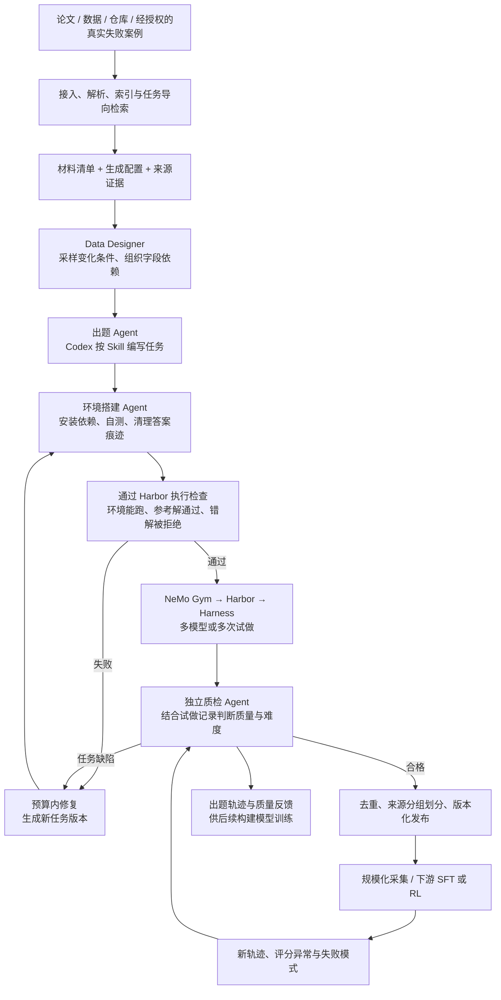
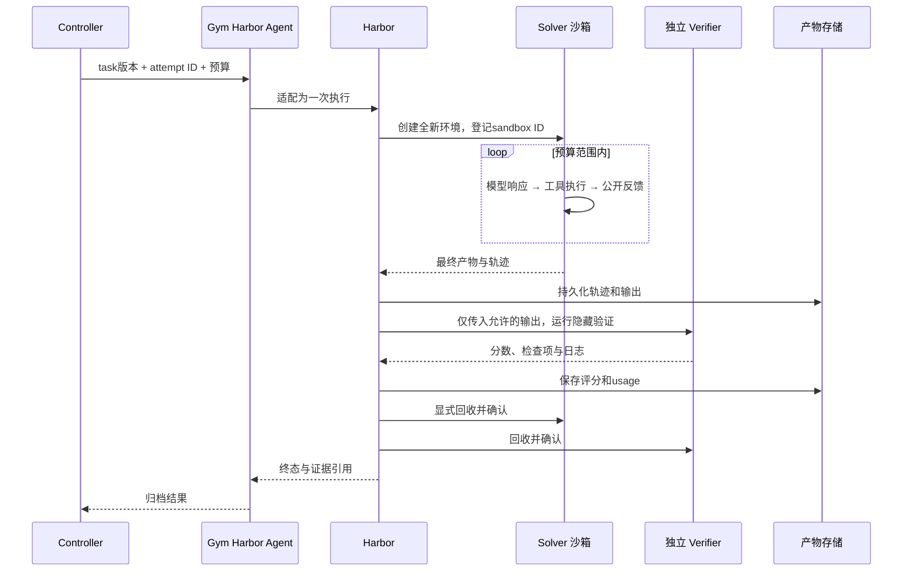

# 第十四章：我们怎样搭建科学任务生产与训练数据采集系统

> 日期：2026-09-16。状态：开发设计与预算假设，尚未部署或验证。本文中的工期、吞吐、通过率和 token 用量都是项目规划值，不是实测或 DeepSeek 公布的参数。
>
> 目标：用 **NeMo Data Designer + Codex/Author Harness + Harbor + NeMo Gym + 现有 CPU 沙箱集群**，实现“科学材料 → 任务构建 → 环境验证 → 多次试做 → 独立质检 → 修复 → 数据发布 → 新轨迹回审”的完整闭环。
>
> 上级：[设计索引](../scientific-data-generation-design.md)；前置：[组件选型](13-data-designer-gym-harbor-architecture.md)；原文：[第 5 章中文译文](../DeepSeek-V4.1-Flash%20技术报告：第%205%20章「后训练」中文译文.md)。

## 1. 这套系统要解决什么问题？

假设一位环境工程同事有几篇论文、一份污水监测数据和一个分析代码仓库。他希望把这些材料变成一批任务，用来检验或训练模型的数据分析和编程能力。今天，这通常需要他逐个编写题目、安装依赖、准备参考解和测试，再找模型试做。材料一多，人工就很难持续维护。

我们要做的系统，是把这些工作组织成一条可以重复运行的生产流程。同事提供材料、说明希望考察的能力，并选择一个已经验证过的生产模板。系统负责组织出题、搭建环境、运行检查、安排试做，并把合格任务和执行记录整理出来。

最后交付三类东西：

1. **任务包**：公开题目、所需输入、可运行的环境，以及只供评测系统使用的参考解和评分程序。
2. **执行轨迹**：模型输出了什么、调用了哪些工具、工具返回什么、最后提交什么，以及最终得分。
3. **质量报告**：任务依据哪些材料生成，哪些检查通过了，模型试做表现如何，发现过什么问题，修复了哪些版本。

例如，同事应该能看到：“本批生成了 100 个候选任务，其中 70 个通过检查。剩余任务分别因为数据不完整、环境构建失败或题意与测试不一致被退回。”这里的数字只是后文预算的示例，不是我们已经实现的产量。

### 1.1 阅读时会遇到的几个名字

| 名称 | 在本方案中的含义 |
|---|---|
| Agent | 能调用工具、执行操作，并根据反馈继续工作的模型程序 |
| Author / Builder / Reviewer | 出题、搭建环境、质检三种角色；可以用同一种框架加载不同指令来承担 |
| Solver | 实际进入环境做题的 Agent |
| Harness | 驱动 Agent 工作的软件，负责模型调用、工具执行与反馈传递 |
| rollout / attempt | 一次从开始到结束的做题尝试；同一道题可以尝试多次 |
| Oracle | 执行已知参考解，检查任务至少有一个可行解 |
| Verifier | 检查最终结果并给出分数的程序 |
| 沙箱 | 为一次执行准备的隔离环境，用完后回收 |
| Controller | 我们编写的流程管理服务，记录进度、安排工作、控制预算并处理失败 |
| SFT / RL | 监督微调 / 强化学习，分别利用示范数据或执行奖励改进模型 |

### 1.2 我们准备复现到什么程度？

“完整复现”分为三个层次，验收时必须分别说明：

| 层次 | 交付内容 | 能否仅靠上述三件套完成 |
|---|---|---|
| A：数据生产流程 | 任务与环境合成、试做、质检修复、去重、难度标注、发布和回审 | 可以用三件套加项目适配层实现，本文主体 |
| B：训练闭环 | 训练 Solver、训练任务构建模型；用新模型重新采样与评估 | 还需可训练的开放权重模型、GPU、训练框架和数据适配 |
| C：DeepSeek 同等底层工程与效果 | 百万沙箱、自研放置调度、token 级暂停、KV/路由恢复、多教师全词表 OPD、同等模型收益 | 公开信息不足，三件套不提供等价实现；不能承诺逐项精确复制 |

DeepSeek 报告披露了流程和若干工程机制，没有公开出题模型训练配方、难度奖励公式、数据配比、全部质检阈值和 DSec 实现。本方案对应其行为做可测试的替代设计。任务构建模型训练和 Solver RL 都列入后续研发阶段，不以提示词迭代冒充模型训练。[原报告 §5.1–5.2](https://huggingface.co/deepseek-ai/DeepSeek-V4.1-Flash/blob/main/DeepSeek_V41_Tech_Report.pdf)

**KR2.1 的首个交付点是 A：其他同事给出任务需求、选择材料和模板后，无需改底层代码即可得到有来源和验证证据的任务。** B 用来检验这些数据是否真的提升模型能力。完成 A 不等于证明训练收益。

## 2. 各个工具怎么配合？

整个过程是：先找材料，再安排 Agent 出题和搭环境，接着让模型试做，最后结合执行记录检查题目。发现问题后，修复题目并重新检查。下图中的不同角色代表不同工作职责，不要求第一版部署成许多独立服务。



| 组件 | 它在这里负责什么 | 我们还需要写什么 |
|---|---|---|
| Data Designer | 按配置组织批量生成，处理各步骤之间的依赖 | 定义输入字段，接入出题函数，把结果交给下一阶段 |
| Codex / 出题框架 | 实际读材料、写文件、运行工具，完成“材料变成任务”的函数 f | 角色指令、Skill、工作目录、交付文件要求与执行限制 |
| Harbor | 加载任务、启动环境，运行解题程序和评分程序 | 科学任务包、现有集群接入、答案隔离与验收检查 |
| NeMo Gym | 接入模型和 Agent，通过已有 Harbor 集成路径运行任务 | 转换任务请求、收集结果，并验证取消和超时处理 |
| Kubernetes / OpenSandbox | 提供 CPU、内存和隔离环境 | 配置资源上限、复用镜像，保证用完后回收资源 |
| 我们的流程管理服务 | 跟踪进度，决定下一步做什么 | 预算、失败处理、版本、发布和多个作业之间的资源分配 |
| 数据库和文件存储 | 数据库存状态和索引，文件存储保存大文件 | 记录格式、文件完整性检查、备份和发布清单 |

Data Designer 的“自定义列”，可以理解为我们写的一段 Python 处理函数。每条输入记录经过它，补上生成结果。例如，原来只有论文、数据和代码路径的记录，经过出题函数后，多出任务包位置、执行状态和日志位置。

自定义列需要保持输入输出记录数量一致。一份材料要生成 5 道题时，先在两个阶段之间展开成 5 条请求，再交给下一个工作流。去重和合并记录也放在阶段之间处理。

如果外部 Codex 自己调用模型 API，这些请求没有经过 Data Designer 的模型客户端，其模型限流设置就不会自动约束 Codex 内部调用。我们需要另外限制同时运行多少个 Codex 会话，以及它们总共能使用多少 API 额度。[自定义列](https://docs.nvidia.com/nemo/datadesigner/concepts/custom-columns)、[执行引擎](https://docs.nvidia.com/nemo/datadesigner/dev-notes/async-all-the-way-down)

Gym 已有 Harbor Agent，但上游示例默认使用 Singularity、自定义 Terminus2，并有模型路由与轨迹配置。不能直接将示例复制进 Kubernetes 就认定可用。现有内部 Harbor fork、上游 Harbor 和 Gym 的版本差异是第一个集成风险。[上游配置](https://github.com/NVIDIA-NeMo/Gym/blob/main/responses_api_agents/harbor_agent/configs/harbor_agent.yaml)

### 2.1 谁决定执行顺序，谁负责失败重试？

如果多层系统同时对同一失败重试，容易重复执行和计费。我们按下面的方式分工：

- Controller 管跨阶段状态和全局预算；不重复实现逐 token 的 Agent 循环。
- Data Designer 管单次生产中的字段依赖与就绪计算。修复循环由 Controller 发起新版本，避免把无限循环塞进生成列。
- Gym 集成路径负责 rollout 请求；Harbor 负责单次环境与 Harness 执行。确认谁控制并发后，把另一层上限设为不额外扩增任务数。
- 传输错误允许客户端有限重试；基础设施故障由 Controller 创建新 attempt；任务缺陷由 Repair 修改任务版本。Solver 解错不自动重试为“成功样本”。
- 原则是“至少一次投递 + 幂等提交”，不宣称跨外部 API 的严格 exactly-once。网络中断可能已产生费用，恢复前先核对外部执行状态。

上面“幂等”的意思是：同一条工作指令因网络异常被重复送达时，系统能够识别它已经执行过，复用已有结果，避免重复发布。外部 API 则可能已经处理并计费，只是结果没有传回来，所以不能保证任何故障下都绝不重复调用。

## 3. 系统需要保存哪些记录？

保存这些记录，是为了回答三个问题：任务从哪里来；为什么认为它合格；发现问题后，哪些结果需要重新检查。英文名称是开发用的数据类型，使用界面可以显示中文。

### 3.1 对象

| 对象 | 必填内容 |
|---|---|
| SourceBundle | 来源 ID、文件 URI/hash、论文页段、数据版本、repo commit、授权与来源类别 |
| GenerationRequest | 目标能力、任务类型、变体、公开要求、生成模板版本、预算、来源列表 |
| TaskVersion | task_id、version、parent_version、公开/隐藏包引用、镜像 digest、来源、生成配置 hash |
| Attempt | attempt_id、task_version、模型返回标识、Harness/版本、预算、seed、状态、外部 sandbox/job ID |
| QualityReport | 环境/Oracle/负例/泄露检查、语义质检、缺陷代码、证据 URI、审核者 |
| DifficultyCard | 同配置下 n/k、置信区间、耗时/token、失败分类、初步/复核状态 |
| DatasetRelease | 不可变 manifest、来源分组、划分、任务/轨迹版本、筛选规则与完整成本 |

幂等键：`hash(request_id, source_digests, workflow_version, variant_id, stage, task_version, attempt_index)`。这个识别码由请求、材料、流程版本和尝试序号共同决定。系统收到重复请求时，用它查询已有工作。

每个执行 Worker 还要领取带有效期的工作凭证。凭证过期，或者工作已转交给其他 Worker 后，旧 Worker 不能再覆盖新结果。实现时可使用租约和递增的执行编号（fencing token）。任务修复后保存为新版本，不覆盖已经发布的旧目录。

### 3.2 存储布局

```text
sources/<source_id>/<digest>/...
requests/<request_id>/config.json
tasks/<task_id>/<version>/public/...
tasks/<task_id>/<version>/private/...
attempts/<attempt_id>/{events.jsonl,raw_trace,artifacts,usage.json,result.json}
reports/<task_id>/<version>/{qualification,review,difficulty}.json
releases/<release_id>/{manifest.jsonl,metrics.json,costs.json,README.md}
```

数据库存索引和状态，文件与大轨迹放存储。公开包、私有包必须有不同访问边界；不是在一个 Solver 可读目录里换个名字。原始轨迹只追加保存，统一事件索引指向原始证据；转换训练格式时再序列化。

### 3.3 Harbor 打包

受信任的打包/执行层组装 `instruction.md`、`task.toml`、`environment/`、`solution/solve.sh`、`tests/test.sh` 等 Harbor 约定文件。Solver 实例只得到公开内容；solution/tests 留在控制与独立 Verifier 一侧。具体挂载需按锁定版本测试。[任务约定](https://docs.harborframework.com/core-concepts/tasks/overview)、[独立 Verifier](https://docs.harborframework.com/core-concepts/tasks/separate-verifier)

**正式 Solver 不接收 Recipe、Scientific Skills、参考解、评分器、Author 轨迹和 Reviewer 反馈。** Oracle 和 Solver 使用不同的干净实例。隐藏检查不回注下一次 Solver；公开题目中声明且随环境提供的测试可以作为正常工具反馈。

## 4. 一组科学材料怎样一步步变成任务？

先用表格说明整体流程，再用污水数据分析案例展开每一步。阶段编号用于开发和日志查询，使用者不需要记住。

| 阶段 | 输入 → 输出 | 处理与验收 |
|---|---|---|
| S0 接入与检索 | 原材料+需求 → SourceBundle | 文件/commit 固定；抽样核对解析；20 条人工标注需求检查检索；保留无匹配情况 |
| S1 可行性 | SourceBundle → feasibility.json | 能否构建、运行和自动验收；缺数据、许可或运行条件的来源明确拒绝 |
| S2 任务设计 | 来源+能力目标 → TaskSpec | 每条公开要求映射到可检查验收点；声明必要科学假设、单位、误差容限 |
| S3 环境构建 | TaskSpec → 候选包 | Builder 安装依赖、准备工作区和测试；参考解、构建日志、清理报告完整 |
| S4 准入 | 候选包 → 已准入版本 | 两次干净 Oracle 验证；空产物和至少 3 类典型错误解拒绝；检查私有文件泄露 |
| S5 校准试做 | 已准入版本 → 校准轨迹 | 固定模型/框架/预算；先 4 次，必要时补到 8–16 次；不同配置分别统计 |
| S6 独立质检 | 包+轨迹 → 质量/难度报告 | Reviewer 分析错误归因；新任务族人工复核；失败进入有界修复 |
| S7 发布与采集 | 合格版本 → 任务集/轨迹集 | 来源分组去重划分，冻结 manifest；生产 rollout 与校准轨迹区分用途 |
| S8 回审 | 新轨迹 → 任务状态更新 | 每轮使用形成新证据；异常触发复查；缺陷任务停用并追踪受影响发布 |

S4 中科学数值任务使用容限或性质检查，不盲目要求字符串完全匹配。仓库修改任务补充 fail-to-pass 与 pass-to-pass。没有唯一答案的任务先定义客观合同，再用经校准的语义评审补充；不能仅凭另一个 LLM 的赞同发布。

### 4.1 用一个案例展开整个过程

**第一步：找到相关材料。**

同事提出：“我要训练模型根据进出水监测数据计算污染物质量负荷，并处理单位差异。”系统检索已有材料，返回论文段落、数据文件和分析代码。记录应指向具体论文页码、数据版本和代码提交。人可以确认这些材料是否适用。没有匹配材料时，系统明确说明缺什么。

**第二步：判断能不能做成可验证任务。**

Agent 查看数据格式，尝试运行代码，并检查必要输入是否齐全。例如，计算质量负荷需要浓度和流量；如果只有浓度，就不能直接出这类题。输出的可行性报告说明可以考察什么、需要补什么、哪些运行条件已验证。

**第三步：写清楚题目与验收要求。**

出题 Agent 根据目标能力写题目，说明单位、缺失值规则、输出格式和允许误差。每条测试要求都要在公开题意中有依据。例如，评分程序要求按日期排序，题目就应明确提出。此时得到任务设计说明，还不是最终任务包。

**第四步：把环境和文件真的搭出来。**

环境搭建 Agent 安装依赖，放入初始代码和数据，编写参考解及测试，并在容器内实际执行。公开内容与私有参考解、测试分别保存。参考解生成的答案文件必须从 Solver 的初始环境中移除。

**第五步：检查任务有没有明显缺陷。**

系统在干净环境运行参考解，确认它能通过。再提交空文件、单位换算错误、忽略流量等典型错误结果，确认评分程序会拒绝。数值结果使用合理误差比较。如果错误答案通过，应先修复测试，再开始正式试做。

**第六步：让模型实际做几次。**

Gym 和 Harbor 配合启动新的解题环境。Solver 只看到公开题目和输入，按照正常工具反馈执行。它结束后，独立评分程序检查结果。成功和失败轨迹都保存，用来判断这道题对指定模型和预算有多难。

**第七步：结合执行记录审核题目。**

独立质检 Agent 同时看题目、环境、评分程序和轨迹。如果模型反复在时间对齐上失败，需要分清是模型没有理解公开规则，还是题目根本没说清楚。发现任务缺陷后，修复 Agent 生成新版本，再次验证。最多修复几轮由配置决定。

**第八步：发布合格任务并采集更多数据。**

合格任务先去重，再按来源划分训练集和留出评测集。同一仓库或同一材料衍生出的近似题目，应放在同一侧，避免训练内容泄漏到评测。发布清单固定任务与环境版本，再按需要采集更多轨迹，整理为评测记录或训练数据。

**第九步：使用过程中继续复查。**

更强的模型可能找到一种符合题意、却被测试误判的解法。系统要保留证据，暂停有问题的任务版本，修复后重新发布，并标明哪些旧数据集受到影响。

### 4.2 第一批先做环境工程编程任务

首个任务族：污水监测数据清洗、流量/单位处理、时间对齐、质量负荷统计，以及在固定分析仓库内实现功能。

- 先做一个环境模板，再做多个有真实能力差异的任务变体。
- 难度通过数据语义、算法约束、仓库依赖和回归要求改变；不通过省略题意、网络故障或无意义的长时间等待改变。
- 论文及参考代码可供 Author/Reviewer 使用；Solver 所需科学定义必须写入公开题目或作为公开输入提供。

### 4.3 第二批做需要操作业务工具的任务

用经授权的工作流程和失败记录，重建有状态的模拟工具服务。每个工具需有 schema、状态转移、业务约束、固定初始状态、reset 与最终状态验证。先做一个“实验样本登记→库存查询→实验排程”的 mock 服务。

不能只模拟 API 返回 JSON：需要检查跨调用的一致性、错误码、副作用、重复提交和权限约束。记录工具版本、状态快照和随机 seed。多轮用户交互脚本也要版本化；模拟用户不携带隐藏答案。使用容器内业务服务或 Gym resource server 的具体路径，在 Spike 中选择一种并验证。

例如，Agent 查询库存得到 10 份试剂，登记使用 3 份后，再查应剩 7 份。如果每次都返回 10，工具就没有真实的状态变化，无法训练可靠操作。新一次试做开始前，还要把库存和排程恢复到相同初始状态。“Spike”指开发前的小规模技术验证，用来确认哪条接入路径可行。

## 5. 使用者填写什么，开发者实现什么？

使用者填写材料位置、任务类型、数量和预算。开发者把这些配置转换成 Data Designer 工作流及后续执行请求。领域变化较大时，需要新增模板；普通使用者复用已有模板。

以下是**项目拟定配置，不是 NeMo 原生 YAML**：

```yaml
campaign_id: wastewater-v1
sources_manifest: sources/wastewater.jsonl
task_family: environmental-coding
candidate_count: 100
workflow_version: science-author-v1
author:
  harness: codex
  model_profile: author-strong
  skill_ref: science-task-author-v1
  session_concurrency: 2
  timeout_minutes: 30
repair:
  max_task_versions: 3  # 初版加最多两轮修复
calibration:
  profile: solver-baseline-v1
  initial_attempts: 4
  default_attempts: 8
  max_attempts: 16
  wall_minutes: 30
  max_model_turns: 64
production:
  attempts_per_released_task: 20
  concurrency: 32
budget:
  currency: USD
  api_hard_limit: 1000
```

这份配置表示：尝试生成 100 道环境工程编程题，最多同时运行 2 个出题会话；初版之后最多修复两轮。先试做 4 次，默认补到 8 次，需要进一步判断时最多 16 次。通过发布检查的任务各采集 20 次执行记录，最多同时进行 32 次生产试做。

整批 API 支出上限设为 1,000 美元。停止条件要在发起新调用前检查，并为在途请求预留费用，不能只在账单已经超限后才停止。单次最长执行时间、最多调用模型几轮，都不能替代费用上限。

`model_profile` 和 `execution_profile` 是单独保存的模型与执行配置，包含模型名称、上下文和 token 上限。密钥从专门的凭据管理中读取，避免出现在配置文件和日志里。

Data Designer 的逻辑列建议为 `source_bundle → feasibility → task_spec → author_result`。长时间构建和 rollout 交由执行 Worker，列中只保存 job/产物引用；Controller 等阶段完成后再输入下一段 Data Designer 工作流。一个来源生成多个变体时，先显式展开成多条请求，再逐行生成。实现时锁定 NeMo 版本，并验证异步自定义列的运行方式。

Author 的 `f` 必须实际运行 Codex 工具循环，不能只让模型输出一个任务目录的文本描述。Author 和 Builder 可以使用同一套 Harness，但使用独立工作区、角色合同与权限。

拟实现内部接口：

```text
POST /campaigns                 -> campaign_id
POST /campaigns/{id}/run         -> run_id
GET  /runs/{id}                  -> stages, budget, failures, artifacts
POST /tasks/{id}/versions        -> new immutable version
POST /attempts                  -> attempt_id (idempotency key required)
POST /attempts/{id}/cancel       -> cancellation_requested
POST /releases                  -> immutable release after gates pass
```

首版用 CLI 调用同一套服务即可，不必先建复杂网页。状态机为 `created → sourcing → authoring → building → qualifying → calibrating → reviewing → released`，并含 `repair_pending/rejected/infra_failed/cancelled/quarantined`。发布并非永久有效：后续确认缺陷时标记 quarantined，保留旧 manifest 和撤回通知。

## 6. 怎样判断题目正确，而且有挑战？

### 6.1 正确性先过门槛

检查至少四方面：公开题意是否充分；环境是否可靠；存在有效解；评分是否能区分正确与错误输出。参考解通过不能独立证明评分器有效。针对典型错误编写负例，并抽查不同实现路径的正确解，降低同一 Author 同时编写解法和测试带来的共同错误。

### 6.2 难度卡

难度和执行条件一起记录：哪一版题目、哪个模型、使用什么框架和工具、允许多少时间和 token。在相同条件下试做 n 次、成功 k 次，观察到的成功率就是 k/n。例如，8 次成功 3 次，记录为 3/8。

但 8 次试做很少，这个比例只能粗略估计难度。报告还应附 Wilson 95% 置信区间，说明估计有多不确定；开发时使用标准的二项比例区间公式。同时记录耗时、token 数和失败原因。更换模型或提高预算后，要另开一组统计。

初版产品策略（可调，不是 DeepSeek 参数）：把已确认正确、且 8 次试做出现成功和失败的任务列入“待复核挑战任务”；全失败进入诊断或提高预算测试；全成功保留基础能力类别或生成更复杂变体。最终发布需要评审任务目标与证据，不依据单一成功率阈值自动宣布优质。

只统计预先规划的有效试做。基础设施失败单列并可补跑；模型自身破坏环境视为 Agent 失败，不伪装成基础设施错误。修复版本不能混入旧版本的 n/k。取消、超时、提前停止和预算耗尽全部记录，防止只保留成功产生选择偏差。

例如，一道题连续失败两次，第三次成功。可以保存第三次轨迹作为训练候选，但评测必须保留前两次失败，不能把它写成成功率 100%。动态增加试做次数时，也要记录追加规则。

### 6.3 将来怎样训练更会出题的模型？

先保存 Author 全过程、TaskSpec、程序检查和独立试做证据。拟定奖励使用门槛：不正确的任务不能因 Solver 失败获得高奖励；正确任务再按目标难度、覆盖新能力、成本打分。第一版用分项报告，不急于合成一个未经校准的标量。

后续先做有监督微调，再试小规模 RL。对比固定基线 Author，在未参与训练的来源和任务族上测合格率、独特任务数、成本和难度分布。参考解与错误解测试、独立 Reviewer、留出 Solver 都不由出题模型自行决定。训练出题模型会增加大量嵌套试做成本，见第 12 节。

## 7. 一次做题怎样启动、结束和清理？

一次做题的完整过程包括：登记尝试编号，创建干净环境，运行 Agent，保存结果，运行独立评分，最后回收资源。即使中途报错或有人取消，也要能知道环境在哪里、留下了哪些结果、有没有清理完。



采用现有 [OpenSandbox 科学轨迹采集技能](/home/qinqinyuan/.codex/skills/opensandbox-science-rollout/SKILL.md) 中的约定：流程管理服务运行在较稳定的开发机或受集群管理的普通作业中；真正做题的沙箱用完就回收。管理沙箱的程序需要比沙箱活得更久，才能在任务结束或失败后负责清理。

每创建一个沙箱，就立即把它的编号和所属任务写入持久存储。无论正常结束、抛出异常，还是收到系统终止信号，都先保存必要产物，再尝试删除沙箱。删除失败则标记为“待清理”，服务重启后继续核对和处理。清理时只处理能够确认属于当前作业的资源，避免影响其他同事。

现有技能记录的 Harbor fork 0.22.0 CPU 镜像 + Terminus-2 + GLM Responses 路径，是内部历史基线，不代表上游 Gym 已验证兼容。优先分别测试：①内部 Harbor 单任务；②Gym 上游 Harbor 示例；③共同后端与模型协议。不能混装两个 Harbor 包后靠隐式导入碰碰运气。

第一版做到“管理服务重启后，知道工作停在哪一步”，并复用已经保存的结果。正在做题的 Agent 能否接着运行，要看所接入框架是否支持；不支持时，就保留原来的失败或中断记录，再开始一次新的尝试。

这里需要区分两种暂停：停止派发新任务比较容易；让已经在执行工具的 Agent 立即暂停，并在之后从同一个位置恢复，是额外能力。第一版不保证每一个 token 都能暂停恢复。修改运行配置后，只对新的尝试生效，避免一条轨迹中途换了规则却没有记录。

轨迹保存以 API 实际返回的内容为准，包括可见的模型输出、工具调用及执行反馈。API 没有返回的内部思维，系统无法额外提取。

做评测或部分监督微调时，这些可见记录可能已经够用。在线强化学习还可能需要每个 token 的编号、生成概率和对应模型版本；如果接口不提供，就需要换成能提供这些信息的推理服务。准备监督微调数据时，要区分模型回答和工具反馈，只有明确允许作为训练目标的模型输出参与损失计算，不能把私有评分内容混进去。

## 8. 开发完成后，怎样证明它真的可用？

验收既要检查正常流程，也要主动制造几种故障。例如，重复提交同一请求、在沙箱创建后让管理程序退出、让 API 返回限流错误。我们需要证明系统不会因此重复发布、无限计费或遗留无法回收的环境。

| 测试 | 必须观察到的结果 |
|---|---|
| 两次投递同一阶段 | 只提交一份有效产物，不重复发布；可识别已发生的外部调用 |
| Worker 在创建沙箱后退出 | ID 已保存，重启可找回并精确清理 |
| 模型 429/5xx/断连 | 有界退避、完整费用记录，无递归重试风暴 |
| Solver 尝试读取私有文件/canary | 无法访问；日志有审计证据 |
| Oracle、空产物、错误解、另一正确实现 | 正确解通过，典型错解拒绝；误判有诊断 |
| 修改测试或题目 | 新版本重新准入，旧版指标与新版本隔离 |
| Gym/Harbor 取消、超时 | 停止创建新任务，产物归档，资源最终释放 |
| 同源近似任务 | 去重且进入同一数据划分，不泄漏到留出集 |
| 新同事换一组材料运行 | 只改输入和配置，公共执行代码不改 |

发布前必须满足以下要求：

- 每个任务都能追溯到材料来源、任务版本和检查记录。
- 每次执行都有明确状态；尚未完成清理的执行必须标出，不能悄悄丢失。
- 隐藏答案和评分程序的隔离测试通过。
- 已发现的严重题意或评分问题全部处理完。
- 首批试运行任务全部经过人工审核。后续对已经稳定的任务类型可以抽样检查，新类型仍然逐个审核。

报告应如实说明抽样范围。“本次没有发现问题”不能写成“已证明永远没有问题”。

## 9. 人员与工期：两名全职工程师的 10–12 周规划

建议两位工程师分别负责“材料与任务质量”和“执行与运行保障”，持续协作 10–12 周。还需要科学专家每周投入 0.5–1 天审核领域内容，以及平台工程师在前两周协助接入集群。具体人员分工需要团队商定。

第 6 周争取让编程任务场景先交给同事试用；之后再补业务工具任务、持续回审和运行稳定性。每一阶段完成后都有可检查的产物，而不是到最后才演示。

| 周期 | A：任务/数据工程 | B：执行/基础设施工程 | 可验收输出 |
|---|---|---|---|
| 第 1 周 | 合同、一个手工黄金任务、来源样例 | 验证版本兼容性，跑通一个 Gym/Harbor 任务 | 固定软件版本清单、真实轨迹、接入结论 |
| 第 2–3 周 | 检索输入、DD Author 列、TaskSpec/Skill | 环境构建、文件存储、进度记录与重复请求处理 | 10 个候选任务跑通 |
| 第 4–5 周 | 负例、科学质检、难度卡 | 独立 Verifier、批量校准、成本记录 | 编程任务闭环，故障测试通过 |
| 第 6 周 | 同事试用、任务与SFT导出 | 32 并发逐级压测、回收与监控 | 编程场景内部可用版（KR里程碑） |
| 第 7–8 周 | 一类使用模拟业务工具的任务 | 会保存状态的工具服务，以及重置、版本和回放 | 两类任务进入统一合同 |
| 第 9–10 周 | 来源划分去重、回审、留出评测 | 稳定性、配额、备份和恢复 | 完整数据生产版与运行手册 |
| 第 11–12 周 | 新来源和缺陷修复缓冲 | 兼容问题及容量调整缓冲 | 发布证据和后续训练立项依据 |

工期假定已有可用 CPU 集群、镜像仓库、存储和 API 账户。新建隔离平台、等待供应商配额、复杂科学软件许可证可能延长关键路径。第一周若 Gym 适配阻塞，允许 Harbor 独立 smoke 继续验证任务逻辑，但 Gym 集成门槛不能因此标为完成。

## 10. 需要多少机器和存储？

第一阶段采用模型 API。模型推理由供应商完成，我们自己的机器主要用于读取数据、构建环境、执行代码和测试。因此，环境工程编程任务的首批系统可以主要使用 CPU 集群，不必先购买用于模型推理的 GPU。任务本身需要 GPU 仿真或深度学习时，另设一类资源。

下面的容量分为两个概念：**同时运行需要多少资源**，以及**整批运行累计占用了多少资源时间**。前者决定集群配额，后者用于估算费用。

### 10.1 起始资源规格（待 10 个任务测量后调整）

| 执行角色 | 每个实例预留 CPU | 每个实例预留内存 | 平均耗时规划与限制 |
|---|---:|---:|---|
| Author / Builder | 4 vCPU | 16 GiB | 初版会话平均 30 分钟；构建另设阶段上限 |
| Solver | 4 vCPU | 8 GiB | 平均 30 分钟，长任务单独队列 |
| Verifier | 2 vCPU | 4 GiB | 平均 5 分钟 |
| Reviewer | 2 vCPU | 4 GiB | 平均 5 分钟，主要等待 API |
| 单任务准入（预算合并项） | 4 vCPU | 8 GiB | 平均 10 分钟，含构建摊销及 Oracle/负例；必须实测 |
| 控制/数据库/Gym 服务总预留 | 8–16 vCPU | 32–64 GiB | 常驻 |

表里的“预留”对应集群配置中的 request，表示调度时需要为任务准备的资源。实际允许使用的最大值叫 limit，需要在试运行后设置。可以参考 p95，也就是约 95% 的观测值不超过的资源用量，并为少数较大任务留出余量。不能只靠超额安排任务来堆高并发，否则容易出现内存不足和互相干扰。

这里的 vCPU 是集群分配 CPU 的计量单位，不一定等同于物理核心。GiB 是内存容量单位。申请资源时应与平台统一口径。已有共享集群可以申请相应配额，不必单独购买机器；本次没有查询当前剩余容量。

| 阶段 | Solver 并发 | 建议可用容量 | 存储规划 |
|---|---:|---|---|
| 开发验证 | 4 | 32 vCPU / 128 GiB，含少量构建与服务 | 0.5 TB 热存储 |
| 团队试运行 | 32 | 192 vCPU / 768 GiB，例如 3×64核256GiB；其中 Solver 128核、构建16核、Verifier16核、服务8核，余量24核 | 2 TB 热存储 + 5 TB 归档 |
| 扩展试产 | 128 | 640 vCPU / 2.5 TiB，例如10×64核256GiB；按负载实测调整 | 5 TB 热存储 + 10 TB以上归档 |

以 32 个 Solver 同时做题为例，每个预留 4 vCPU，就需要 128 vCPU。再给环境构建预留 16、评分预留 16、常驻服务预留 8，总共是 168 vCPU。规划 192 vCPU 后，还有 24 vCPU 余量。这是表中建议容量的来由。

建议多个任务共享基础镜像缓存，节点使用 SSD 或 NVMe 存储，内网优先采用 10 GbE。大量读取共享文件系统的小文件、同时下载镜像，或者模型 API 限流，都可能拖慢执行，所以增加 CPU 不一定能同比提高产量。这些机器规格是容量建议，不是云厂商报价。

### 10.2 一批 100 个候选任务，会产生多少次做题？

先把预算假设写清楚：

1. 生成 100 个候选任务。
2. 假设其中 70 个最终合格，合格率为 70%。
3. 每个合格任务用 8 次试做判断难度，共 560 次。
4. 每个合格任务再采集 20 次执行记录，共 1,400 次。
5. 两部分相加，共 1,960 次做题尝试。

这里的一次做题通常会调用模型很多轮，所以“1,960 次做题”并不意味着只有“1,960 次 API 请求”。后面的 token 费用按全部请求累计计算。

为了方便替换规模，可以使用下面的公式：

令 N 为候选数、q 为最终合格率、k 为每个合格任务校准次数、r 为生产采集次数：

```text
合格任务期望数 = N × q
rollout 次数 R = N × q × (k + r)
Solver 预留核时 = R × 单次时长(h) × 单次vCPU
Verifier 核时 = R × 验证时长(h) × 验证vCPU
理论 rollout 完成率 = 并发 / 单次时长 × 有效利用率
```

预算示例假设 q 是最终发布合格率，且这些任务各校准 k 次。实际还有“校准后被拒绝任务”的花费，应以单独的额外 attempt 项记录；示例的 30% 预备金仅作初始缓冲，不能永久代替计量。

32 并发、平均 30 分钟、有效利用率 65% 时，理论上约 41.6 次 rollout/小时、998 次/天。100 候选、q=70%、k=8、r=20 对应 1,960 次 rollout，仅 Solver 阶段约 47.1 小时；构建、质检、人工等待和配额可能拉长总周期，不能把它当端到端承诺。

若单次累计输入 300k、输出 30k token，上述速度约需 208k 输入 TPM、20.8k 输出 TPM，另加 Author 和 Reviewer 用量。RPM 还取决于每条轨迹的模型调用次数。供应商公布的并发限制不等于本账号稳定吞吐或公司代理配额。

存储估算必须分开：原始轨迹、输出文件、任务输入、共享基础镜像、增量镜像层。以 1,960 条轨迹每条 5–20 MB，加平均 100 MB 产物为例，约 206–235 GB，尚未计任务数据、镜像、备份。禁止每条轨迹复制完整仓库镜像。

## 11. API 单价、批次预算与完整成本

### 11.1 模型 API 怎样收费？

模型通常分别计算输入和输出 token 的费用。输入是每次发给模型的题目、对话和工具结果；输出是模型生成的内容。多轮执行可能反复提交已有上下文，所以一条最终只有几万 token 的轨迹，累计计费输入也可能达到几十万甚至更多。

下表是 2026-09-16 核对的公开价格，单位是美元／百万 token。缓存输入是供应商确认命中缓存的输入，不能根据我们自己觉得“内容重复”就直接按缓存价计算。

| 模型/计费条件 | 未缓存输入 | 缓存输入 | 输出 | 用途候选 |
|---|---:|---:|---:|---|
| DeepSeek V4.1 Flash 高峰 | 0.30 | 0.006 | 1.20 | 低成本批量 Solver |
| DeepSeek V4.1 Flash 低峰 | 0.15 | 0.003 | 0.60 | 可排队的批量 Solver |
| GPT-5.6 Sol 标准短上下文档，当前促销价 | 4.00 | 以实时价页为准，预算不用折扣 | 20.00 | Codex Author / Reviewer / 强 Solver |

DeepSeek 当前高峰为工作日 UTC 01:00–04:00、06:00–10:00，其余时段低峰。Sol 促销输入/输出价官方称至少持续至 2026-11-21；长上下文、服务层级与其他收费工具需另算。第一版预算均按无缓存、高峰/标准价，不假定所有回传上下文都命中缓存。[DeepSeek价格](https://api-docs.deepseek.com/quick_start/pricing/)、[Sol模型价](https://developers.openai.com/api/docs/models/gpt-5.6-sol)、[OpenAI价格细则](https://developers.openai.com/api/docs/pricing)

Codex 是处理方式/Harness，API 费用按所用模型计算，不能把个人订阅当无限批量额度。现有 GLM 公司代理价、限流和模型版本需要供应方给出，本方案不把配置中的 cost=0 当免费。API 账单币种为 USD；人民币预算使用财务指定汇率，不用未核实的即时汇率。

### 11.2 100 个候选任务的费用，具体怎样算出来？

输入 token 为**整次执行所有请求的累计计费输入**，不是最终上下文长度；输出包含供应商计费的推理 token。以下为用量假设，不是测量：

| 阶段 | 每次累计输入 | 每次累计输出 | 次数 |
|---|---:|---:|---:|
| Author（含可行性/构建期间模型调用） | 200k | 30k | N |
| Reviewer 总用量 | 80k | 8k | N |
| Repair | 120k | 20k | 0.3N，假定每次一轮 |
| Solver | 300k | 30k | N×q×(k+r) |

基准方案让出题、质检和修复使用 Sol，批量做题使用 Flash 高峰价。假设 100 个候选任务里有 30 个需要修复一次，并产生上述 1,960 次做题尝试。

逐项计算如下，均未使用缓存折扣：

| 工作 | 单次输入费用 | 单次输出费用 | 单次合计 | 次数 | 小计 |
|---|---:|---:|---:|---:|---:|
| 出题 | 0.2 × $4 = $0.80 | 0.03 × $20 = $0.60 | $1.40 | 100 | $140.00 |
| 质检 | 0.08 × $4 = $0.32 | 0.008 × $20 = $0.16 | $0.48 | 100 | $48.00 |
| 修复 | 0.12 × $4 = $0.48 | 0.02 × $20 = $0.40 | $0.88 | 30 | $26.40 |
| 做题 | 0.3 × $0.30 = $0.09 | 0.03 × $1.20 = $0.036 | $0.126 | 1,960 | $246.96 |
| **合计** | | | | | **$461.36** |

为额外调用和初期估算误差增加 30% 预备金后，得到约 $599.77。这是这个假设下的 API 预算，不包含服务器、人力等全部项目成本。

```text
单次模型费用 = 累计输入/1e6 × 输入单价 + 累计输出/1e6 × 输出单价
总 API 费用 = 各阶段次数 × 各阶段单次费用之和
申请额度 = 总 API 费用 × 1.30
每个合格任务成本 = 批次全部费用 / 实际合格任务数
```

| 情景 | 候选数 | 期望合格数 | 校准+生产 rollout | API基准 | 加30%预备金 |
|---|---:|---:|---:|---:|---:|
| 小批闭环 | 20 | 14 | 392 | $92.27 | $119.95 |
| 团队试运行 | 100 | 70 | 1,960 | $461.36 | $599.77 |
| 批量试产 | 1,000 | 700 | 19,600 | $4,613.60 | $5,997.68 |

这些价格下 试运行批次单条 Solver 轨迹约 $0.126；若全部 Solver 改为 Sol，同样 token 假设下 API 总计约 $3,742.40，加预备金约 $4,865.12。模型选择和轨迹长度远比调度代码影响费用。

如果轨迹比预想更长，费用会怎样变化？例如，把每条 Solver 累计输入增加到 1M、输出增加到100k，Flash 试运行批次 约 $1,037.60，加预备金约 $1,348.88；Sol 则约 $11,974.40，加预备金约 $15,566.72。这不是上限；必须以逐请求硬预算限制失控长轨迹。Sol 情景假设每次请求仍在标准价适用范围，若单请求跨长上下文阈值需重新定价。

### 11.3 服务器、人力和存储怎样计费？

4 vCPU 的环境占用半小时，就是 2 vCPU·h。即使其中一部分时间在等待 API，只要这些 CPU 配额仍为任务保留，就可能需要按占用时间计费。内存也类似：8 GiB 占用半小时，就是 4 GiB·h。具体以公司实际结算方式为准。

基准试运行批次工作负载约 **4,570 vCPU·h**，包括 Author、Reviewer、Repair、准入、Solver 和 Verifier 的上述时间假设，不含常驻服务、空闲整机、GPU、复杂镜像冷构建、额外拒绝任务校准和重新评审。对应内存约 9,620 GiB·h。需要为失败和无法充分利用的资源空隙另留余量。

这些核时由以下部分相加得到：

| 工作 | 预留 CPU 核时 |
|---|---:|
| 出题：100 次 × 0.5 小时 × 4 vCPU | 200.00 |
| 质检：100 次 × 5/60 小时 × 2 vCPU | 16.67 |
| 修复：30 次 × 20/60 小时 × 4 vCPU | 40.00 |
| 任务准入检查：100 次 × 10/60 小时 × 4 vCPU | 66.67 |
| Solver：1,960 次 × 0.5 小时 × 4 vCPU | 3,920.00 |
| Verifier：1,960 次 × 5/60 小时 × 2 vCPU | 326.67 |
| **合计，按未四舍五入值计算** | **4,570.00** |

还需要向公司平台确认是按“实际申请的资源时间”收费，还是按“整台机器租了多久”收费。两种算法选其一，不能把整机费和相同资源的核时费重复相加。

```text
共享集群按量价 = vCPU·h × 内部CPU单价 + GiB·h × 内存单价
              + 存储GB·月 × 单价 + 网络/镜像/备份费用
专属整机价 = 节点数 × 租用小时 × 节点小时价（不要再重复加CPU/内存计费）
总项目成本 = API + 集群 + 存储网络 + 工程人力 + 科学审核
```

CPU/内存/存储单价目前没有报价，脚本默认 `null` 并输出“未计价”，绝不把未知当零。举例若内部已确认 CPU 单价为某值，填入后重算；不要把这个参数当公开云价。两位工程师 10–12 周是约 20–24 工程人周，另计科学专家与平台支持。

首批推荐 API 硬上限 $1,000（混合模型），先运行 10 候选实测，再放开到100；这只是支出保护设置，不是预计一定花完或一定够用。改用强 Solver 或长任务前重新申请预算，不靠无限重试维持通过率。

预算工具：[脚本](../../tools/estimate_pipeline_budget.py)、[基准参数](../planning/pipeline-budget.example.json)。运行：

```bash
python tools/estimate_pipeline_budget.py docs/planning/pipeline-budget.example.json
python tools/estimate_pipeline_budget.py docs/planning/pipeline-budget.example.json --candidates 1000
python tools/estimate_pipeline_budget.py docs/planning/pipeline-budget.example.json --solver sol
```

## 12. 数据管线做好后，怎样进入模型训练？

到这里，我们可以生产任务、采集轨迹并检查质量。要证明这些数据改善了模型，还需要真正训练一个模型，并做独立评测。这一阶段需要额外的 GPU 和训练工程，不能把 API 采集费用当成模型训练费用。

### 12.1 先验证这些数据是否带来能力提升

选择可训练、工具协议适配的开放权重模型，冻结来源划分。先比较：基础模型、加入同等 token 的通用数据、加入本流水线数据。使用未参与生产校准的任务族或仓库进行评测；同时报告能力提升、成本和回归。SFT 训练只需要合适的输出监督；在线 RL 还需策略版本、token IDs、logprobs、loss mask 与框架一致性。

### 12.2 再训练解题模型和出题模型

引入训练后端（如 slime），Gym/Harbor 保留环境适配角色。选定唯一 rollout 主调度方后再集成，不能让 slime 与 Gym 各自重复调度同一批样本。先实现完整 attempt 边界的异步采样、策略版本记录和过旧样本过滤；不承诺立即实现 DeepSeek 的 token 级恢复。

GPU 资源先按小实验预约，再实测调整：

- 对 70–80 亿参数的稠密模型，如果采用 LoRA 这种只训练少量附加参数的方式，并把上下文控制在 8k–16k token，可以先申请 1–2 张 80GB 显存的 GPU 做监督微调容量测试。
- 小规模 RL 可以先预约 8 张 80GB 显存 GPU、256GB 以上 CPU 内存、高速互联，以及独立的 CPU 沙箱池，验证最小训练流程是否能运行。
- 这些只是容量测试的起点。是否训练全部参数、优化器状态怎样分散保存、是否同时加载参考模型和价值模型、需要多少推理副本，都会改变显存需求。实测前不能保证上述配置一定够用。
- 320 亿参数模型、长上下文、多教师全词表蒸馏都需要单独估算，不包含在前面的数据生产预算中。

出题模型 RL 的成本按“构建候选数量 × 每个候选的验证与Solver试做”嵌套增长。例如10,000候选、每题8次试做，即至少80,000次Solver调用链，尚未计构建、修复和被拒绝任务。训练费用按GPU小时报价，无法用API token价格替代。

### 12.3 哪些能力需要另外立项研究？

token级中断、KV缓存跨检查点复用、MoE专家路由重放、40+教师全词表蒸馏、百万级调度分别设专项设计与性能实验。闭源API不暴露所需内部状态；CPU沙箱数量也不等于GPU推理并发。优先复用现有Kubernetes，在真实调度瓶颈出现前不复刻DSec自研调度器。

## 13. 下周开始开发，具体先做什么？

第一周的目标，是确认几个关键组件真的能接起来，并拿到第一份真实执行记录。此时先做一个人工检查过的任务，不急着批量生成，避免把任务本身的错误和组件接入问题混在一起。

1. 固定一个科学任务包，手工确认Oracle、负例和公开要求。
2. 锁定 Data Designer/Gym/Harbor/模型SDK/容器后端版本与镜像digest，保存 `versions.lock`。目标命令必须在此阶段根据实际版本实现，不把本文接口示意当已存在CLI。
3. 先让 Data Designer 执行简单的 Python 加法，确认输入输出和批量处理正常；再接入出题函数，让 Codex 生成真实任务目录。
4. 单独跑 Harbor oracle/solver/separate verifier，再通过Gym集成运行同任务，对比产物与分数。
5. 验证模型API工具调用、reasoning字段、usage、取消与超时，记录哪些训练字段不可得。
6. 在测试中主动让流程管理服务退出，再重启，检查它能否找回已创建的沙箱并完成清理。
7. 用 10 个候选任务测量实际 token 用量、运行时长、内存需求和新增镜像大小，整理失败原因，再更新预算。

最终交付：两个任务族、一套可配置生产模板与接口、任务/轨迹数据集、质量与难度报告、成本报表、运行手册和新同事独立运行证据。真实训练收益单独由B阶段报告。

### 13.1 开始批量运行前，需要补齐的信息

- 公司实际可申请CPU、内存和存储配额及内部单价。
- Codex与Solver采用的模型快照、公司代理价和账户RPM/TPM。
- Gym与内部Harbor fork是否兼容，后端先用 Docker-in-Docker 做开发验证，还是接入 OpenSandbox 隔离环境。
- 领域专家可投入的审核时间、首个数据源可用性、最终训练框架与目标模型。

这些信息会改变容量与预算，但不阻止先执行第一周的单任务集成验证。本文仅完成设计与预算工具，没有提交集群任务、购买资源或调用付费模型。
