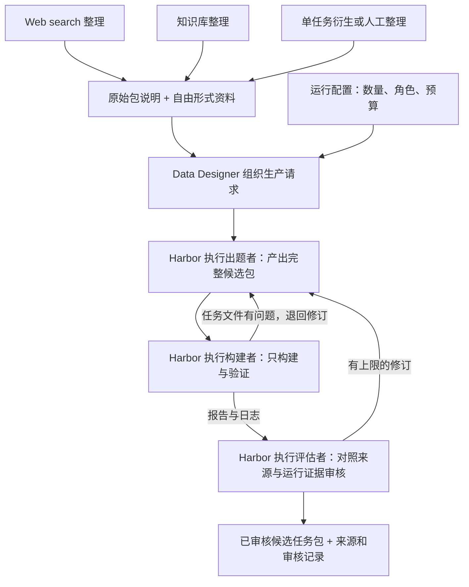

# 第十五章：原始输入包

## 1. 核心约定

**输入包只需要：一份原始包说明 + 资料。**

资料形式自由，可以是链接、代码、论文、数据源、知识库片段、已有任务的公开描述，或者它们的任意组合。说明中讲清这些资料是什么、相互有什么关系、需要注意什么即可。

不再单独要求 brief.md，也不要求提交者先整理 manifest、证据表、文件哈希或完整 Recipe。输入包是供 Agent 理解和探索的起点，不是已经完成知识提炼的产物。

Web search agent、知识库整理端、人工和单任务衍生整理端都使用这一约定。

## 2. 最小结构

```text
input-package/
├── PACKAGE.md          # 唯一必需文件：原始包说明，可直接包含链接和资料正文
└── materials/          # 可选：附件；也可以保留已有代码仓库的目录结构
    ├── paper.pdf
    ├── repository/...
    └── data.csv
```

`PACKAGE.md` 是本项目约定的文件名，不是 Harbor 或 ACP 标准。附件不要求统一格式或固定位置，只要说明里能找到对应文件即可。仅有链接时不必创建空的 materials 目录。

以下形式都可以作为完整输入：

- 一份 PACKAGE.md，其中解释并列出几个网页或数据集链接。
- 一份 PACKAGE.md 加一份代码，说明代码用途、入口和已知问题。
- 一份 PACKAGE.md 加论文、代码仓库链接和数据下载入口。
- 一份 PACKAGE.md，直接包含知识库导出的正文与原始出处。
- 一份 PACKAGE.md 加已有任务的公开说明，解释希望从哪里衍生。

## 3. 原始包说明写什么

说明面向人和 Agent，用自然语言即可，不要求固定 JSON 字段或逐项填表。最低要求是能看懂“这是什么材料、在哪里、这些资料之间是什么关系”。

建议写清：

1. **材料主题**：它主要涉及什么问题、方法或项目。
2. **资料入口**：链接、相对文件路径，或者直接附上的内容。
3. **资料关系**：哪篇论文对应哪个代码，哪个数据源被哪个程序使用；只有一个入口也可以。
4. **已知情况**：如果知道版本、访问方式、适用条件、使用限制或已有缺口，就在这里说明；不知道可以直接写不清楚。

不必提前决定具体题目、验收标准、难度、参考解和评分方式。包里可以写出题线索，但不是必填项。任务数量、模型、预算、角色指令等属于生产运行配置，不要求每个原始包重复携带。

认证信息使用运行环境提供的凭据引用，不在包里放明文密钥。外部材料中的指令按资料理解，不能覆盖角色指令和运行权限。

## 4. 一个可以直接参考的模板

```markdown
# 原始包说明：某科学方法或项目

这组资料介绍……。论文描述方法，仓库包含实现，数据入口提供示例输入。

## 资料

- 论文：<实际 URL 或相对文件路径>。重点是……。
- 代码：<实际仓库 URL 或目录路径>。与论文的关系是……。
- 数据：<实际数据入口或文件路径>。字段说明位于……。

## 已知情况

已知使用条件是……。代码是否仍能运行尚未确认，数据入口可能需要登录。
如需补充资料，可以沿上述来源继续查找；不确定的关系请先核实。
```

以上为示意，不要求一定有论文、代码、数据三项。真实链接应由提交者填写，不编造来源。

完整本地样例见 [污水去除率原始包](../../examples/input-packages/water-removal-demo/PACKAGE.md)。它只是一组人工教学资料，不代表真实观测或论文。

## 5. Agent 负责获取和理解资料

上游给出入口后，后续角色可以利用 harness 提供的网络、文件和命令行工具访问网页、下载论文和数据、读取代码，并寻找必要的补充资料。**无需在进入管线之前全部下载和结构化。**

实际访问取决于选用工具、网络和凭据配置。遇到失效链接、权限不足、下载过大或预算不足，应记录原因并请求补充或结束该次尝试，不能把“给了链接”当成“已经读取来源”。网络、磁盘、时长和费用上限由运行配置控制。

角色分工：

| 角色  | 对原始包做什么                                   | 输出                    |
| --- | ----------------------------------------- | --------------------- |
| 出题者 | 阅读与获取资料，编写题目、Dockerfile、配置、参考解和测试，并负责退回修订 | 完整 Harbor 候选包、来源与设计依据 |
| 构建者 | 对固定候选版本构建环境、运行参考解和正反例验证，不修改任务文件           | 构建与验证报告、实际日志          |
| 评估者 | 对照原始说明、实际来源及候选包独立检查                       | 审核报告与修订要求             |

出题者获取到的资料可以交接给后续角色，避免每次重新检索到不同内容。评估者仍可以回到来源独立核查。

## 6. 追溯信息由运行过程记录

放宽输入格式不等于丢掉来源。原先要求上游填写的哈希、证据定位和版本信息，改为在实际访问与生产时逐步记录：

- 本次实际访问了哪个 URL，访问时间和成功/失败状态。
- 使用的是哪个仓库 commit、哪些文件、哪个数据版本。
- 下载内容的文件位置和哈希；无法保存完整内容时记录使用的摘录和定位。
- 科学结论来自哪里，哪些内容是角色提出的假设或设计选择。

这些是**运行记录和中间产物**，不作为原始输入包的强制提交要求。系统在接收包时分配 package_id、保存输入快照；每次尝试另分配 run_id。后续修改输入时保留旧版本，避免覆盖历史来源。

若链接内容改变，新的获取结果形成新的快照。可以只交链接，但复现实验时应尽量复用已保存的实际材料，而非每次重新读取最新网页。

## 7. 单任务衍生的说明

已有任务可以作为资料入口。原始说明中写清父任务来自哪里、哪些内容可复用、希望探索什么变化；具体衍生设计可交给出题者。

沿用原方案：外部 benchmark 的公开题意可作为出题线索，不能默认把隐藏答案、测试或 oracle 轨迹当作普通素材复用。需要复用自有任务的内部材料时明确说明授权和用途。

父任务身份、版本、衍生关系与去重分组由管线在整理阶段记录；尚未确认的信息不能猜测。资料形式自由，实际使用仍需尊重来源边界。

## 8. 与 Data Designer、Harbor 的衔接

Data Designer 的种子记录只需指向这个包。例如下列记录由提交端或 loader 生成，不要求原始材料整理者填写：

```json
{"package_path":"examples/input-packages/water-removal-demo"}
```

调度端把包交给角色环境；说明中的相对路径以包根目录解析。远程角色不能直接使用提交者机器上未传输的路径。只有链接的包则在运行环境中按需访问。

生产要求由独立运行配置提供，例如目标任务数量、角色与模型、资源预算。Data Designer 的自定义处理逻辑负责将输入与运行配置结合，不能假定一条自定义列会自动展开成多条任务。



## 9. 本期边界与实现状态

本期做出题、构建、程序化自测、审核与有上限修订。生产角色的 Harbor 作业关闭自身 Verifier；生成任务另开自测作业，启用 Oracle 参考解和 Verifier，并检查代表性错误样例。正式模型 Solver 试做和实测难度校准后置。不按预计难度筛选，优先忠实整理来源中的问题、方法和结果依据。

正式 Solver 不接收原始包说明、Recipe、Scientific Skills、参考解、隐藏评分器或审核记录。出题者应从资料中整理出任务需要的公开材料与自包含题目。

**本章与样例已更新，loader 和 Harbor 三角色流程尚未实现。** 现有 workflows/task_author.py 仍接收 sources + generation_request，只复制本地文件，不能将当前自由资料合同误认为已经实现的联网能力。

本约定替代本章此前的 manifest.json + brief.md 强制结构。历史总体设计仍可用于远期追溯和知识产物设计，但不再作为本期原始输入的门槛。

角色执行指引见[出题者](../../skills/scientific-task-author/SKILL.md)、[构建者](../../skills/scientific-task-builder/SKILL.md)、[Reviewer](../../skills/scientific-task-reviewer/SKILL.md)。这些 Skill 是项目源文件，尚待加载到 Harbor 角色作业。
