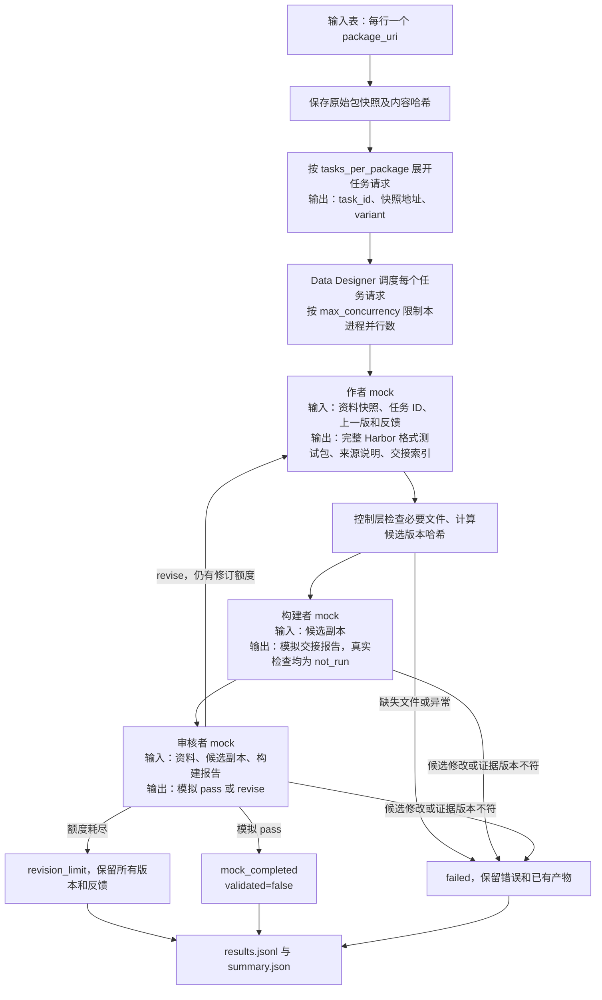

# 从原始资料包到任务包：第一版可运行管线

> 本页聚焦 mock 模式。真实 API 与 Harbor 执行方式见[真实运行指南](17-live-pipeline.md)。

## 这一版完成什么

Data Designer 已实际执行批量处理；三个角色由确定性 Python mock 代替。可以验证输入展开、文件交接、修订循环、失败处理和归档。没有调用 Codex、启动 Docker、执行参考解或判断科学正确性。

真实资料选用 [Pywaterflood](https://github.com/frank1010111/pywaterflood)，包含 [JOSS 论文](https://joss.theoj.org/papers/10.21105/joss.06191)、代码与仓库示例 CSV。整理后的输入是 `examples/input-packages/pywaterflood/PACKAGE.md`。

**mock 生成的是明确标注的加法测试包，并非从 Pywaterflood 推导出的科学任务。** 它只用于检验管线的机械流程。mock 的两个包仅有测试输入差异，不能用来证明科学任务多样性。

## 怎么运行

在项目根目录，激活安装好本项目的 Conda Python 3.12 环境：

```bash
export UV_PROJECT_ENVIRONMENT="$CONDA_PREFIX"
uv sync --locked --inexact
sci-pipeline --config examples/pipeline/mock.json
```

当前机器为避免改动已有环境，实际使用的环境位于 `runs/conda/sci-skt-pipeline`，也可直接运行：

```bash
runs/conda/sci-skt-pipeline/bin/sci-pipeline --config examples/pipeline/mock.json
```

默认读取 `examples/pipeline/seeds.jsonl`。每行只需要：

```json
{"package_uri":"examples/input-packages/pywaterflood"}
```

当前支持本地目录。相对地址以 `--source-root` 为基准，默认是执行命令时的工作目录。资料中的论文、数据和代码链接写在 PACKAGE.md 中；mock 不下载链接。以后接入真实作者时由作者读取它们。

`tasks_per_package=2` 将每个原始包展开为两个任务请求。管线分配独立 task_id，Data Designer 对展开后的每行调用自定义生成函数，返回任务包地址及状态。不会要求上游人工重复填写资料包地址。

## 流程和输入输出



`max_revisions=1` 表示首次出题后最多再修订一次，共两版。默认 mock 配置设置 `mock_revise_once=true`，专门走一次退回路径；将它设为 false 可验证直接完成路径。

mock 构建报告的真实状态是 `validation_pending`，附加 `simulated_status` 供模拟状态机使用；审核报告同理，使用 `simulated_decision`。最终不会据此将任务标为真实通过。

## 配置放在哪里

| 配置类别 | 位置 | 内容 |
|---|---|---|
| API 接入 | `.env`，模板 `.env.example` | OPENAI_API_KEY、SCI_PIPELINE_MODEL、可选 OPENAI_BASE_URL |
| 运行策略 | `examples/pipeline/mock.json` | 每包任务数、并发数、修订上限、mock 行为 |
| 后续 Harbor 参数草案 | `examples/pipeline/harbor.json` | 角色/验证超时、Codex 版本、角色镜像 |
| 角色职责 | `skills/scientific-task-*/SKILL.md` | 三角色工作规则和文件交付格式 |
| 软件依赖 | `pyproject.toml` + `uv.lock` | Python 包及锁定版本 |
| 输入资料 | 原始包内 `PACKAGE.md` 与附件 | 论文、代码、数据及其关系 |

mock 不读取 `.env`，不需要密钥。Data Designer 可能提示默认模型提供商缺少密钥，这是库初始化提示；当前只有自定义 Python 列，没有模型生成列，实际执行会显示 `no model usage recorded`。

为下一步准备 API 配置时，填入本地 `.env`：

```dotenv
OPENAI_API_KEY=填入实际密钥
SCI_PIPELINE_MODEL=填入接口支持的模型名
OPENAI_BASE_URL=
```

地址留空代表计划使用 OpenAI 官方默认端点。第三方网关需要填入其兼容端点；实际 Codex 兼容性要留到下一阶段验证。密钥不应放在 seeds、运行 JSON 或 pyproject 中。

可单独检查配置项是否齐全：

```bash
sci-pipeline --check-api-config --env-file .env
```

这个命令只检查变量是否存在和地址格式，不请求 API，不证明模型、密钥或网关可用。环境变量优先于 `.env`；读取不会把密钥注入整个 Python 进程。`ApiSettings` 用 SecretStr 隐藏 repr/JSON 中的密钥。

`role_timeout_sec`、`validation_timeout_sec`、`codex_version`、`role_image` 对 mock 没有执行效果；真实模式的配置和限制见[真实运行指南](17-live-pipeline.md)。

## 代码如何分工

```text
src/sci_pipeline/
  cli.py         命令入口、原始资料快照、任务展开和批次汇总
  config.py      严格解析运行配置；单独读取 API 配置
  contracts.py   请求、角色交接结果、最终状态和后端接口
  designer.py    Data Designer 自定义列及并发参数映射
  pipeline.py    三角色顺序、有界修订、版本检查和结果判定
  artifacts.py   文件读写、路径检查、内容哈希和任务文件检查
  mock.py        三角色的确定性测试替身
```

没有再造调度平台。Data Designer 控制自定义列的本进程并发，控制层处理每个任务内部的阶段依赖与修订。`RoleBackend` 只是三个方法的边界，下一阶段可接 Harbor；并非额外的 agent 框架。

单个任务失败保留结果，不会把整批其他任务结果丢掉。批次只要有未完成任务，CLI 返回非零退出码。文件系统或 Data Designer 层面的异常保留 `run-error.json` 后退出。每次运行使用新目录，不自动重用旧任务；当前没有断点续跑、跨进程配额或分布式队列。

## 输出如何看

```text
runs/pipeline/<时间-随机标识>/
  run-config.json               不含 API 密钥的有效运行策略
  versions.json                 Python 与主要依赖实际版本
  inputs/                       原始包快照
  input-manifest.json           原始地址、快照地址和内容哈希
  expanded-seeds.jsonl          Data Designer 实际接收的展开记录
  designer/                     Data Designer 原生数据集和统计产物
  tasks/<task_id>/
    events.json                 阶段、候选版本和模拟决策
    revision-000/
      author/tasks/<task_id>/   task/ 和 authoring/
      builder-input/           候选副本
      builder/                 构建报告与未执行项
      reviewer-input/          候选副本
      reviewer/                审核报告
      feedback.json            需要修订时的反馈
    revision-001/              修订后新版本，旧版仍保留
    result.json
  results.jsonl                 每个任务的最终状态和 task_package_uri
  summary.json                  批次计数；mock 明确 validated=false
```

每个证据绑定候选内容哈希，防止将旧版报告直接当作新版通过。候选副本在角色返回后重新计算哈希，改动被判失败。**这是程序完整性检查，不是恶意代码隔离**；真实角色仍须在各自容器中运行，并只读挂载输入。

## 已完成的验证与下一步

本轮在 Conda Python 3.12.14、Data Designer 0.9.2、Harbor 0.23.0 下完成两个请求的真实 Data Designer mock 批处理，每个都经历一轮修订，无模型用量。单元测试覆盖修订上限、角色改动候选、旧版证据、带阻断问题的通过决策、路径越界及配置隔离；生成的 task.toml 使用固定 Harbor 版本的解析器检查。

复验：

```bash
python -m unittest discover -s tests -v
sci-pipeline --config examples/pipeline/mock.json
```

尚未验证：真实 Codex 三角色、容器只读隔离、产物回收、Oracle/Verifier 和反例检查、科学正确性审核。mock 包文件存在以及 TOML 可解析，都不能替代这些检查。正式 Solver、Gym rollout 和难度校准仍在后续阶段。
