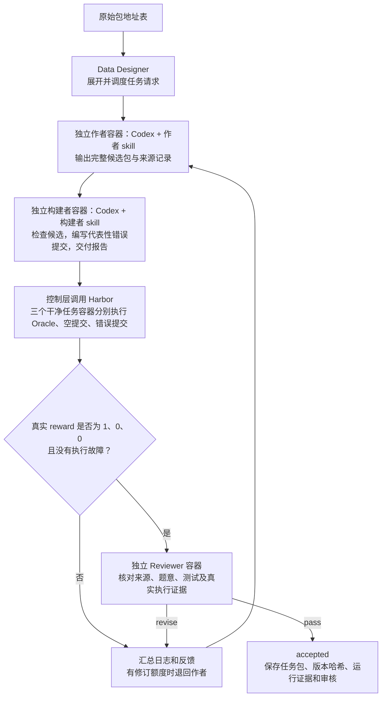

# 真实 API 与 Harbor 运行

本页说明真实执行入口和部署配置。是否已经通过完整验收，应以对应运行目录的 summary.json、validation.json 和 review.json 为准，不以“模型调用成功”代替任务验收。

## 支持范围

- 控制进程：Conda Python 3.12，依赖按 uv.lock 安装。
- 执行后端：Docker 的 Linux 容器模式；需要 Docker CLI、Compose 和 Buildx，以及访问 daemon 的权限。
- 角色：Harbor 0.23.0 内置 Codex，CLI 0.154.0，分别启动干净容器。本期通过 API key 使用 Responses 兼容端点；第三方端点仍需实际验证工具调用兼容性。
- 任务：单步、CPU、Dockerfile 构建，公开题目、参考解、测试。暂不接 compose、GPU、预构建任务镜像或多步骤协议。
- 资料：本地原始包可包含远程论文、代码和数据链接。容器需要能获取这些实际用到的资料，或由上游提供离线快照。

该范围是当前实现边界；尚未通过 Windows/macOS、不同 CPU 架构和所有 Docker 版本的测试，不能承诺任意环境即开即用。

## 新机器上的操作顺序

```bash
conda env create -f environment.yml
conda activate sci-skt-pipeline
export UV_PROJECT_ENVIRONMENT="$CONDA_PREFIX"
uv sync --locked --inexact
cp .env.example .env
chmod 600 .env
# 编辑 .env，填入实际 API 配置。

# 只构建共享角色基础镜像，不调用模型。
sci-pipeline --build-role-image --config examples/pipeline/harbor.json

# 检查本地前置条件，不调用模型。
sci-pipeline --doctor --config examples/pipeline/harbor.json

# 开始真实生成；会使用模型额度。
sci-pipeline --config examples/pipeline/harbor.json
```

基础镜像 Dockerfile 位于 runtimes/harbor/role-image/，固定了 Node 基础镜像摘要和 Codex 安装版本。它预装 Python、Git、curl、ripgrep。角色作业在此基础上加入本次输入；无需每个任务重新安装工具。镜像构建时的系统包仍取自发行版软件源，实际镜像 ID 由 doctor/运行记录保存。

如果组织已发布兼容镜像，可先拉取，修改配置中的 role_image，跳过本地构建。镜像需要包含指定版本 Codex、node 用户和上述工具。严格复现部署时建议将 role_image 配置为组织仓库的镜像摘要。

## `.env` 只放接入信息

| 变量 | 是否必填 | 说明 |
|---|---|---|
| OPENAI_API_KEY | 真实运行必填 | API key；仅注入角色作业，不注入 Oracle/反例任务容器 |
| SCI_PIPELINE_MODEL | 真实运行必填 | API 接受的模型标识；三个角色暂时共用 |
| OPENAI_BASE_URL | 可选 | API 根地址，例如 https://example.com/v1；不要填成 /v1/responses |
| SCI_PIPELINE_CONTAINER_PROXY | 可选 | Docker 构建和容器内部使用的 HTTP(S) 代理，必须从容器内可达 |
| SCI_PIPELINE_CONTAINER_NO_PROXY | 可选 | 不走容器代理的主机列表，默认 localhost,127.0.0.1 |

宿主机环境变量优先于指定的 `.env` 文件，可通过 `--env-file` 切换。mock 不读取它。不要把 key 放进运行 JSON 或资料包。

宿主机的 localhost 代理不能直接作为容器代理：容器里的 localhost 指向自身。需要代理时，使用组织提供的可达地址，或本机已配置并允许容器访问的代理入口。管线支持 `host.docker.internal` 的 host-gateway 映射，但不会自行修改宿主机代理监听地址、防火墙或共享 Docker 服务。代理 URL 不接受内嵌认证信息。

本机 API 连通不代表容器联网也正常。doctor 的 api_connectivity/container_network 字段为 not_checked，避免把仅检查配置和镜像的结果误称为网络验证。

## 运行配置控制行为与资源

| 参数 | 默认值 | 作用 |
|---|---|---|
| tasks_per_package | 1 | 每个原始包产生多少个任务请求 |
| max_concurrency | 1 | 本进程最多同时执行多少个任务流程 |
| max_revisions | 1 | 首次出题后最多修订几次 |
| max_role_attempts | 2 | 每个角色交付不完整或格式不符时的总尝试次数，与科学内容修订分开计数 |
| role_timeout_sec | 1800 | 单个生产角色执行时间预算 |
| validation_timeout_sec | 1800 | 单次参考解/反例和评分的时间预算 |
| job_overhead_timeout_sec | 1200 | 单个 Harbor 作业额外预留的构建、安装和清理时间 |
| environment_cpus | 2 | 单容器 CPU 预算上限 |
| environment_memory_mb | 4096 | 单容器内存预算上限 |
| docker_builder | default | 仅对本项目子进程选择 Buildx builder，不执行全局 buildx use |
| role_image | sci-pipeline/role:codex-0.154.0 | 共享角色基础镜像 |
| codex_version | 0.154.0 | 与基础镜像内 CLI 对齐的版本 |
| generation_guidance | 空字符串 | 可选生成侧约束；不是原始包必填 brief |
| difficulty_guidance | 空字符串 | 自定义难度设计偏好；真实示例已填写 TB-Science v0.1 引导，不是实测难度标签 |

当前每个任务内部顺序运行三个角色与自测。多个任务可并行，因此资源需求随并发增加。候选包声明超出 CPU/内存预算时会报错，不静默降低它的资源要求并假称已按原要求验证。

难度引导全文可直接修改 examples/pipeline/harbor.json 的 difficulty_guidance。它随运行配置归档并注入作者，作者在生产侧 DESIGN.md 说明难点与目标差距；不进入公开任务环境，也不增加主观难度淘汰门槛。留空恢复不指定难度的行为。依据及全部 70 题分析见[难度设计](19-difficulty-guidance.md)。

Harbor 原生自动重试关闭。控制层只对交付缺文件、格式不符等情况按 max_role_attempts 补跑，传入上一轮不完整产物和明确错误，不无限重做。内容修订由 max_revisions 限制的作者循环负责；基础设施故障需要修复明确配置或环境问题后再运行。这些尝试都可能消耗模型额度，并保留独立日志。

每个角色输入只包含自己的 skill、原始资料或所需交接文件。管线附带固定 Harbor 版本的最小格式说明，减少模型为了查任务格式而下载无关工具仓库。归档允许指向包内文件的链接并将其实体化；越界链接、目录循环和特殊设备文件会被拒绝。

## 真实阶段做什么



角色容器内不挂 Docker socket。构建者可以读候选并编写验证辅助脚本，实际任务容器由宿主控制层通过 Harbor 启动。这样不需要给角色操作宿主机 Docker 的权限。

角色生产作业关闭 Verifier；候选任务自测作业启用 Verifier。不是正式模型 Solver 试做。三个自测容器使用相同候选环境，分别运行已有参考解、不做修改、以及构建者生成的错误提交。

构建者最初输出中的未执行项保持 not_run；完成真实自测后，控制层保存原始 builder-agent-result.json，再以真实回执生成 validation.json 和最终 builder-result.json。Reviewer 读取这些真实记录。不会用模型一句“我运行成功了”代替执行证据。

## 结果和费用记录

`results.jsonl` 给出任务包地址及状态；`tasks/<id>/revision-*/` 保存每次角色产物。原生 Harbor 作业与模型日志位于各角色的 `*-runtime/attempt-*/execution/jobs/`。`preflight.json` 保存实际运行环境和角色镜像 ID。

`usage.json` 汇总 Harbor 报告的三个角色 token 用量。Data Designer 仅负责自定义列调度，它自己的模型用量统计不包含 Codex 消耗。第三方模型价格未知时 cost_usd 保持 null，不套用其他模型价格。API 账单以提供方记录为准。

accepted 代表本版候选通过当前自测与独立审核；不等于数学意义上的完全正确，也不代表已测难度。后续仍需正式 Solver、更多反例和实际使用反馈。

## 常见故障的配置方向

- 找不到 Docker/Compose/Buildx：安装执行前置工具，检查当前用户 daemon 权限。
- 找不到角色镜像：先构建，或修改 role_image 指向已拉取的兼容镜像。
- Codex 版本不一致：重建角色镜像，或同时调整镜像和 codex_version。
- 镜像构建 DNS/下载失败：检查所选 docker_builder 的网络，必要时配置可达容器代理；不把失败归为科学题目不正确。
- API 认证或模型不可用：检查 `.env` 中模型、根地址与 key，不使用宿主机 Codex 登录状态代替。
- 原始资料不可访问：提供可读取的链接或必要快照，保留缺口，不伪造已阅读。
- 超时：先查看对应 Harbor 原生日志。正常退出由 Harbor 删除容器；强制终止时若出现 cleanup-pending.json，需要核对其中所属作业的资源，不做全局 Docker 清理。

首次移植到新环境，先跑 mock，再做一个真实任务。扩大并发前确认 API 配额、CPU/内存和镜像缓存能力；当前没有跨进程全局限流或分布式调度。

## 用时记录

每次生成作业结束时（包括失败），CLI 写出 `timing.json`：记录管线实际起止时间、总秒数，以及各角色和三种自测的原生 Harbor 用时。角色汇总包含格式重试。并行运行时各阶段可能重叠，不能把阶段时间相加当作总体耗时。环境准备和历史失败排障另行记录，不计入单次正常生成。

首个真实通过案例及时间、token 记录见[运行记录](18-live-acceptance.md)。
