# 可选的任务 Skill 提炼

## 目标和开关

在任务通过构建自测与独立审核后，从该任务提炼一份能够指导同类问题的 Skill。此功能是任务生产的可选附加步骤，不恢复旧设计中“先从原始资料抽取 Recipe 与 Skills，再出题”的前置链路。

运行配置添加：

```json
{
  "generate_skills": true
}
```

以上字段加入完整运行配置即可；默认 false，示例配置也保持关闭。不新增 API 凭证项；使用现有 Codex 模型、API、Harbor 角色镜像、角色超时和交付格式重试配置。

## 流程

```mermaid
flowchart TD
    A[原始包] --> B[出题]
    B --> C[构建与自测]
    C --> D[独立任务审核]
    D --> E[通过验收的 Task Package]
    E --> F{generate_skills}
    F -->|false| G[交付任务结果]
    F -->|true| H[Skill 提炼者]
    A -.来源副本.-> H
    C -.验证记录副本.-> H
    H --> I{有可复用方法?}
    I -->|否| J[记录 not_applicable]
    I -->|是| K[独立 Skill 审核者]
    K -->|通过| L[Skill 包与任务关联记录]
    K -->|不通过| M[记录 rejected 与具体问题]
    H -->|执行失败| N[记录 failed]
    J --> G
    L --> G
    M --> G
    N --> G
```



提炼者读取原始资料、任务说明、参考解、测试、设计来源、构建与任务审核记录。审核者独立读取相同证据及 Skill 草稿，不接收提炼者内部轨迹。

两个新角色使用独立 Harbor Codex 作业，输入是只读副本。Skill 步骤在同一任务行内顺序执行，因此仍受现有 `max_concurrency` 限制；未增加并发层或额外资源调度。

## 内容与验收

第一版每个任务最多交付一份 Skill 包。内容描述使用时机、适用前提、方法选择、核心步骤、科学约束、结果检查及必要的失败恢复；可按需附带 references、scripts、assets。不要求固定章节或强行生成没有复用价值的内容。

参考解与测试是提炼证据，不直接整体复制为 Skill。去掉具体任务的答案、固定最优参数、私有路径与评分器；保留来源支持的通用公式、科学常数和方法约束。通用脚本应参数化，明确依赖。没有运行脚本时不声称其已验证。

程序检查结构、YAML frontmatter、任务 ID、候选版本和 Skill 内容指纹。独立审核者检查方法忠实性、可复用程度、自包含性和是否泄露单题答案；发现实质问题拒绝发布。格式问题使用现有 `max_role_attempts` 重试；语义拒绝不自动循环修复，可显式重新提炼。

本期没有正式 Solver 轨迹或同类新任务实验，因此始终记录 `transfer_evaluated=false`。审核通过表示未发现上述问题，不代表已经证明 Skill 能提高其他 Agent 的成功率。

## 产物和状态

```text
任务目录/revision-000/
├── author/…/task/              # 原 Harbor 包，不增加 Skill
└── skill-extraction/
    ├── draft/
    │   ├── skill-draft.json    # 来源定位与生成判断
    │   └── skills/<name>/
    │       ├── SKILL.md
    │       └── …              # 按需附带资源
    ├── review/skill-review.json
    ├── skill-link.json        # 仅审核通过时生成
    ├── draft-checkpoint.json
    ├── result.json
    ├── inputs/                # 生产侧证据副本
    └── …                      # 独立角色运行记录
```

对外只需交付 `skill_package_uri` 指向的 Skill 目录；不要把整个 `skill-extraction/` 给其他 Agent，因为其中含原任务参考解、测试和生产记录。

每个任务结果增加 `skill_status`、`skill_package_uri`、`skill_report_uri`、`skill_error`。只有 Skill 审核通过时提供可发布的 `skill_package_uri`。状态包括 disabled、pending、accepted、mock_completed、not_applicable、rejected、failed。未通过的任务不调用提炼者，开启功能时其 Skill 状态为 not_applicable。

`skill-link.json` 记录任务 ID、任务版本、Skill 指纹、来源地址和指纹、证据定位及执行模式。导出 Skill 不自动挂载给正式 Solver；`solver_access=false`。

任务状态与 Skill 状态分开。Skill 失败不会撤销已验收任务，也不单独令 CLI 返回失败码；`summary.json` 和终端输出分别汇总 Skill 状态。自动化调用方如要求必须产出 Skill，应检查 `skill_counts` 或各行的 `skill_status`。

## 续跑与重跑

```bash
sci-pipeline --resume /绝对路径/运行目录
sci-pipeline --retry-skills /绝对路径/运行目录
```

- 续跑保留任务及已完成的提炼草稿，重新执行中断的提炼或审核作业。草稿和证据指纹不一致时记录失败。
- `--retry-skills` 只选择 failed / rejected 的 Skill，归档旧提炼记录，从提炼步骤重新开始；不重新出题、构建或审核任务。没有可复用方法的 not_applicable 不自动重跑。
- `--retry-failed` 仍只针对任务本身；新任务通过后再按配置提炼 Skill。
- 应在新批次启动时确定开关，不直接修改已有批次的配置开启补提炼。
- 新增角色的 Harbor 用量和耗时计入现有统计，旧重跑产物保留在 history。

## 验证范围

通过 mock 角色验证开关、正常提炼、审核拒绝、执行失败隔离、输入副本保护、提炼草稿复用、仅重跑 Skill，以及 Data Designer 集成。角色说明通过 skill-creator 格式检查。未调用付费模型、未启动真实容器，尚未进行跨任务 Skill 增益评估。

Skill 提炼与审核同样使用统一执行会话。批次取消会传到对应 Harbor worker，恢复和重跑前检查残留执行；清理不完整时阻止新执行。见 [执行生命周期](22-execution-lifecycle.md)。
