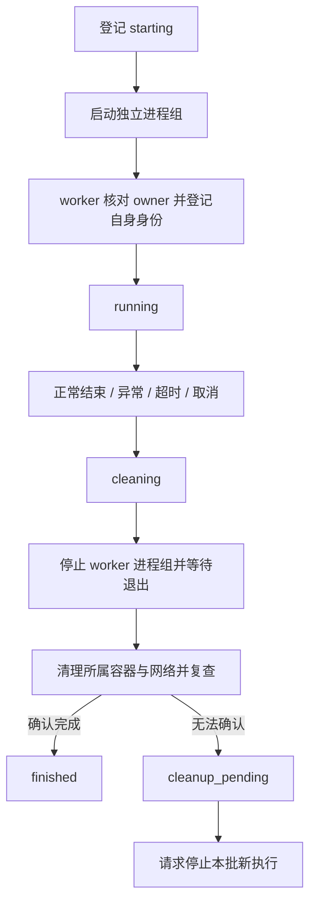

# Harbor worker 与容器的执行生命周期

## 分工

Data Designer 负责行并发与检查点；任务管线负责角色顺序；Harbor 负责容器及 Agent 执行；`HarborRunner` 使用 `ExecutionSession` 统一处理每次 worker 的登记、等待、停止和清理。

当前实现使用同步上下文管理器，直接适配 Data Designer 的工作线程，不额外引入异步调度层：

```python
with ExecutionSession(directory, job_dir, grace=30) as session:
    process = subprocess.Popen(..., start_new_session=True)
    session.attach(process)
    code = session.wait(deadline)
```

退出上下文时，无论成功、异常、超时或取消，均进入统一收尾。运行目录有独占锁；每次执行还有独占锁，worker 启动和退出使用另一把文件锁协调。

## 状态与归属



执行状态与结果分开记录。`finished` 只代表执行资源已收尾，`outcome` 记录 completed、worker_failed、timeout、cancelled、interrupted 或 orphaned。任务是否科学正确，仍由原有任务结果表示。

身份记录包括 execution_id、宿主机名、owner 和 worker 的 PID、进程启动 ticks、进程组 ID、系统 boot ID，以及 Harbor job 路径、停止等待时间、Docker 连接环境变量。执行目录所在路径可以定位任务、revision 和角色。

- `run/executions/<execution_id>.json`：权威执行登记；恢复仅遍历这里，不扫描输入包和模型产物中的同名文件。
- `执行目录/execution.json`：便于就地排查的状态副本。
- `执行目录/worker-identity.json`：worker 在接触 Harbor 前写入的身份和 execution_id。
- `执行目录/cleanup-pending.json`：清理不完整的原因。
- `run/cancel.request`：本批停止请求。

worker 启动时持有 `.worker.lock`，核对 owner 身份和权威执行状态；owner 已退出或状态已经进入收尾时，以 125 退出，不启动 Harbor。这用于缩小父进程在 Popen 前后异常退出的恢复风险。

## 停止与清理

会话最多每 0.5 秒检查一次取消请求。停止时：

1. 保存 cleaning 状态。
2. 核对 worker PID、启动时间、boot ID 和进程组身份。
3. 向所属进程组发送 SIGTERM。worker 将 SIGTERM / SIGINT 转为 asyncio 任务取消，让 Harbor 有机会走自身收尾。
4. 等待 `worker_stop_grace_sec`（默认 30 秒，允许 1～120 秒）；仍有存活成员则 SIGKILL，再有限等待。
5. 确认 worker 启动／退出锁已释放。
6. 依据 trial 的 Compose project 标识或 `sci.pipeline.execution` 标签定位容器、网络，删除并再次查询确认被删除对象不再存在。
7. 保存 finished；若无法确认则保存 cleanup_pending，并阻止本批启动新的 worker。

PID 已被其他进程复用时不发送信号，保留待处理状态。同组普通子进程在 worker 已退出后仍会被检查和停止。进程已停止、容器已删除时，重复停止是安全的。

清理只处理可归属到本次执行的容器、网络及 Docker `rm -v` 涉及的匿名卷。Harbor 正常结束时还按其自身 delete 策略收尾。这里不做全局镜像、构建缓存、命名卷或任务产物清理。

## 操作入口

```bash
# 请求一个正在执行的批次停止；命令返回表示请求已写入，不表示所有资源已清理
sci-pipeline --cancel /绝对路径/运行目录

# 原批次进程已退出后，清理登记中的孤儿执行，不调用模型、不重跑任务
sci-pipeline --cleanup /绝对路径/运行目录

# 续跑／重跑前自动完成恢复检查
sci-pipeline --resume /绝对路径/运行目录
sci-pipeline --retry-failed /绝对路径/运行目录
sci-pipeline --retry-skills /绝对路径/运行目录
```

CLI 收到 SIGINT / SIGTERM 时同样写入取消请求，等待工作线程收尾，而非直接退出。若调用最终正常汇总且检测到取消请求，退出码为 130。已派发的角色因取消结束时，任务或 Skill 会记录相应失败；使用原有失败重跑入口重新执行。尚未完成并无终态结果的任务用 resume。

取消请求不是 Data Designer 的队列清空接口。剩余行仍可能被框架调度到，但 `HarborRunner` 会在启动 worker 前拒绝执行，因此不会再发起新的 Codex 作业。mock 模式没有 worker，本次取消机制主要针对真实 Harbor 执行。

## 启动与恢复检查

持有运行目录锁后，启动或续跑会先检查登记中未 finished 的执行：

- owner 仍活着：拒绝接管，不重复启动。
- owner 已退出、worker 仍活着：停止已确认身份的进程组，再清理环境。
- worker 已退出、容器残留：补清并复查。
- 其他宿主机、Docker 连接环境变量发生变化、身份或清理不确定：报错，阻止恢复。

检查成功后才清除旧取消请求并进入任务调度。`--cleanup` 不清除取消请求，便于保留停止意图。已 finished 的登记跳过；归档历史产物不会重新触发清理。

此机制针对同一 Linux 主机和 Docker 连接环境。没有常驻守护进程；父进程遭 SIGKILL 或机器故障后，孤儿不会保证立即被清理，而是在主动 cleanup 或下一次恢复时处理。若需要无人值守的即时回收，可在后续服务化时增加外部 supervisor／定时检查。

主动脱离进程组的宿主机进程、未携带归属标签且缺失 trial 记录的外部资源，不在此版完整追踪范围内。旧批次没有执行登记，不能据此宣称旧批次已无残留。

## 验证

测试使用真实临时 Python 子进程验证取消、超时、异常、父进程实际强退、孤儿回收、同组子进程收尾、PID 身份不匹配保护及 worker 启动保护。Docker 调用使用 mock，验证只删除所属资源、标签补充定位及删除后残留检测。没有调用付费模型，也没有启动真实 Docker 容器；真实 Harbor 强制中断的端到端验证仍待进行。
