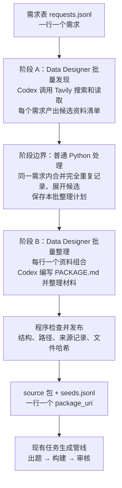

# 需求到 source 包：搜索整理管线开发方案

状态：实现已接入，本文保留设计依据；实际命令、配置和验证边界见[搜索整理运行指南](24-source-pipeline-usage.md)。

本版取代此前的全局资料目录设计：仅合并同一需求内完全重复的候选，保存本次运行的检查点。新批次允许再次使用同一资料，不查询或复用历史批次的包。

## 1. 目标和边界

用户提交想寻找的内容，管线寻找相关资料，整理成 `PACKAGE.md + 自由形式资料` 的 source 包，并输出可直接交给现有任务生成管线的 `package_uri`。

第一版支持 bench、domain 两种入口。两者共用一个搜索整理角色、一份核心 Skill、Codex harness 和 Tavily Search/Extract；区别只是寻找和组织资料的指引。需求仍可用自然语言描述，不要求用户提前设计任务、参考解或测试。

搜索整理角色负责找到用户想要的资料、核实来源之间的关系、清楚说明材料和缺失项。任务设计、Dockerfile、参考解、测试与科学任务审核继续由下游负责。来源不必能在当前机器上直接运行，也不以预判任务难度决定是否收录。

第一版按有限批次执行，部署在同一 Linux 主机、本地文件系统与 Docker 环境。先保证可检查、可恢复、可复用，再考虑共享服务和多机调度。

## 2. 总体结构



### 职责分配

| 组件 | 负责什么 |
|---|---|
| Data Designer | 两个阶段各自的行并发、结果表、框架检查点 |
| 搜索整理角色 | 多轮搜索、阅读、识别论文与代码/数据的关系、说明与整理资料 |
| Harbor / Codex | 隔离执行角色，收回文件 |
| 现有 ExecutionSession | worker、容器的取消、清理和孤儿执行恢复 |
| Python 阶段控制器 | 校验输入、阶段顺序、展开候选、保存计划、导出下游输入 |

两阶段顺序运行，并发只作用于当前阶段的行。角色内部不另开一个批量 Agent 调度器，避免并发数相乘。发现和整理采用同一角色的两种执行模式，但使用独立上下文；整理模式只接收本行资料和明确的补查目标。

## 3. 用户输入

建议 `requests.jsonl` 每行如下：

```json
{"request_id":"groundwater-001","mode":"domain","request":"寻找地下水污染模拟相关研究，优先包含论文、官方代码和公开数据。","entrypoints":[],"max_candidates":10}
```

| 字段 | 规则 |
|---|---|
| request_id | 必填，本批唯一，作为恢复和追溯标识 |
| mode | 必填，bench 或 domain |
| request | 必填，自然语言需求；可包含年份、主题、资料类型等偏好 |
| entrypoints | 可选，用户已知的论文、榜单、仓库或数据入口 |
| max_candidates | 可选，候选资料组合数量上限；建议默认 10，不是必须凑够的配额 |

bench 模式识别 benchmark 名称、版本、任务标识以及关联材料；domain 模式识别论文、软件、数据集及其关系。mode 帮助搜索，不限制自然语言表达。歧义或资料不足写入报告，不能用猜测补成事实。

解析失败、重复 request_id 或字段错误按行记录，不阻止其他有效需求执行；重复 ID 的后续行拒绝，保留行号。输入文件完全不可读、批次配置无效则批次启动失败。

## 4. 阶段 A：发现资料

一个需求对应一次有界角色执行，允许多轮搜索和读取。输出：

```text
requests/<request_id>/discovery/
├── candidates.json
├── report.md
└── result.json
```

每个候选是一个有明确关系的资料组合，例如一篇论文及其代码和数据，或者一个 benchmark 的具体任务。建议候选字段包括：

- `candidate_id`：需求内部的候选标识。
- `title`、`relevance`：是什么、为什么符合需求。
- `sources`：来源类型、原始 URL、已知版本、读取状态。
- `relationships`：论文与代码、数据之间的关系，以及支持关系的来源地址。
- `scope`：本包覆盖范围，如整篇论文材料或某个 benchmark 任务。
- `gaps`：未找到、打不开或尚未确认的信息。

模型整理来源和关系，程序校验字段格式。不凭标题相似就确认两个来源相同，也不因研究主题接近就认定仓库是论文官方实现。

结果区分 `completed`、`no_results`、`failed`。部分候选可用时保留候选并报告不足；搜索接口全面失败不能记成“没有相关资料”。保存有效结果后，resume 不重新搜索该需求。用户想获取更新资料时创建新批次。

## 5. 阶段边界：合并完全重复记录，再展开

等发现阶段各行完成或记录失败后，保存结果，生成第二阶段的输入表。第一阶段一行是一个需求，第二阶段一行是一个候选资料组合；这个转换是保留两阶段结构的主要原因，便于单独恢复和重跑某一个包。

### 合并规则

只比较同一个 request_id 内的候选。候选通过 schema 校验后，使用以下比较值：

```python
def exact_key(candidate):
    return (
        candidate.scope.strip(),
        tuple(sorted({
            (source.url.strip(), source.version or "")
            for source in candidate.sources
        })),
    )
```

要求 scope 为非空字符串，sources 至少有一个有效来源，version 为字符串或 null。版本、benchmark task ID、仓库子目录或文件范围等会改变材料含义的信息，必须体现在 version、URL 或 scope 中，不能只藏在标题里。

用普通 Python 字典按 key 分组：保留首次候选的身份，记录合并进来的 candidate_id，保留各候选的原始说明、关系证据和缺失项。原始 candidates.json 不改写；若证据矛盾，记录分歧，不以“合并”消除矛盾。该 key 只用于本需求的记录比较，不是全局资料身份。

| 两个候选的差异 | 行为 |
|---|---|
| scope 一样，来源 URL 和版本集合相同，仅顺序不同 | 合并 |
| 一个多了数据源，或使用不同 commit | 保留两个 |
| scope 文字不同，即使看起来意思相近 | 保留两个 |
| arXiv 页面和 PDF 地址不同 | 保留两个 |
| 来自不同 request_id 或不同批次 | 分别处理 |

不请求模型判断相似度，不解析 DOI 别名，不改写 URL 查询参数。允许漏掉重复，优先避免错误合并。

例如 r001 找到 A/B/A，r002 找到 A/C：r001 整理 A/B 两项，r002 整理 A/C 两项，共四项。两个需求中的 A 各自处理。同样输入在新批次运行时也重新执行。

### 冻结整理计划

每行包含 item_id、request_id、保留下来的 candidate_id、合并的候选标识、scope 和来源集合。item_id 由程序按 request_id 和首次候选位置稳定生成；原始 ID 使用受限字符或编码后才能用作路径。

计划持久化后，resume 直接读取，不重新搜索或重新排序。输入、配置、Skill 和 schema 版本发生变化时拒绝静默续跑，要求开启新批次。无需 SQLite、跨批次锁、领取租约或包过期策略。

## 6. 阶段 B：整理和发布

输入是一行一个冻结的整理计划：`item_id`、request_id、来源集合、范围、策略版本。Agent 可补查已有候选的缺失关联；发现范围外的新内容写入补充建议，不能无限扩张本行任务。

输出先写入独立 staging 目录：

```text
package/
├── PACKAGE.md
└── materials/       # 可选
```

PACKAGE.md 说明包内是什么、各来源地址与已知版本、材料关系、本地文件用途和缺失项。仍允许只提供链接，不强制下载整个仓库、论文或数据集。遇到无法读取的材料要标明，不能声称已核实内容。

程序检查包括：PACKAGE.md 存在且非空；候选来源有对应记录；本地引用指向包内存在的普通文件；没有越界路径或符号链接；文件清单与哈希可生成。结构检查通过不等于科学内容已经正确，下游 Reviewer 继续承担科学任务审核。

发布采用：校验 staging → 写文件清单与输入指纹 → 同文件系统原子改名为本整理项的交付目录 → 原子保存 result.json。清单放在交付目录内、package 目录外，不改变下游原始包要求。

若改名后尚未保存结果便中断，恢复时核对交付清单、输入指纹和文件哈希，完整则补写结果，不重新调用 Agent；不完整则报告损坏，显式失败重跑时归档旧产物再重建。写入过程复用运行目录独占锁，每个整理项有独立目录，框架重复派发同一项时使用项级锁防止并发写入。

完成的包在本次运行中保持不变。新批次使用独立目录，允许再次整理相同材料。删除运行目录也会删除其中的包；下游使用期间必须保留，长期交付时复制包并重新导出对应路径。

## 7. 输出和文件布局

```text
runs/source/<run_id>/
├── run-config.json           # 非敏感配置与版本快照
├── requests.jsonl            # 有效输入快照
├── input-errors.json
├── requests/<request_id>/    # 搜索结果、报告、执行证据
├── stages/discover/          # Data Designer 阶段产物
├── stages/package/           # Data Designer 阶段产物
├── package-plan.jsonl        # 已冻结的整理计划
├── items/<item_id>/
│   ├── delivery/
│   │   ├── manifest.json     # 输入指纹、文件清单与哈希
│   │   └── package/          # package_uri 指向这里
│   │       ├── PACKAGE.md
│   │       └── materials/    # 可选
│   ├── result.json
│   └── attempts/             # 执行证据和旧尝试
├── executions/               # 复用现有生命周期登记
├── results.jsonl             # 每项状态、需求/候选标识、package_uri
├── seeds.jsonl               # 每个成功整理项一行，续跑不重复追加
└── summary.json              # 数量、耗时、用量、未完成项
```

种子表严格复用现有格式：

```json
{"package_uri":"/absolute/path/runs/source/example/items/item-001/delivery/package"}
```

results.jsonl 保存需求和来源关系；seeds.jsonl 只保留下游需要的包地址，从当前成功结果原子重建。同一材料在不同需求中出现时可以有多个包地址，不在导出阶段进一步合并。

内部报告不成为原始包的必填内容。复制或交付 package 目录时，PACKAGE.md 和所附资料能够独立被理解。

## 8. 恢复、失败与生命周期

两个阶段分别使用普通 `DataDesigner.create()`；阶段控制器保存输入与配置指纹，只有上游计划冻结后才创建下游种子。DD 检查点与业务结果共同使用，行被框架再次调用时先检查业务结果，避免重复副作用。

| 场景 | 行为 |
|---|---|
| 一个需求写错 | 记录输入错误，继续其他行 |
| 一次搜索失败 | 该需求失败；其他需求继续 |
| 发现阶段中断 | 恢复未完成的行，复用已保存候选 |
| 整理阶段中断 | 按冻结计划恢复，先回收孤儿执行 |
| 某个包整理失败 | 保留其他成功包，只重跑失败项 |
| 新批次遇到以前使用过的资料 | 正常执行，写入新批次目录 |
| 容器清理无法确认 | 停止本批新执行，保留 cleanup_pending |
| 磁盘故障或无法保存检查点 | 停止批次，避免继续生产无法保存的结果 |

resume 处理未完成项，复用结果完整的已完成项；retry-failed 明确选择失败项，保留旧尝试。不让框架、角色、工具各自叠加无界重试。复用现有有界交付重试，搜索接口自身重试策略在接入时明确记录。

批次结果区分 completed、partial、failed、cancelled；没有结果也是显式状态。若仍有失败或未完成项，汇总不得声称全部成功。用户可拿成功 seeds 单独运行下游；组合执行时默认等本批完整结束，显式允许部分输入才消费 partial 批次。

失败搜索的重跑结果可能新增候选：为阶段派发保存独立 DD submission，在总整理计划中追加新需求的整理项，已有整理项内容和标识保持不变。已成功搜索的需求不作为失败重跑对象；需要更新搜索结果时开启新批次。

框架恢复不能保证外部 API 恰好调用一次。如果调用已发生但有效产物和检查点尚未写入，恢复后可能需要重试；可保证的是有效结果已经持久化的阶段不被无故重跑。

生命周期复用[现有实现](22-execution-lifecycle.md)，包括同机恢复限制和无常驻回收器的边界。搜索与整理不启动正式 Solver/Verifier。

## 9. 配置与代码边界

建议独立 SourceRunConfig，复用已有执行配置，不向现有任务 RunConfig 塞入无关搜索参数。以下为配置职责；可运行 JSON 使用 execution 对象承载已有 RunConfig，见运行指南：

| 配置 | 建议默认值或规则 |
|---|---|
| max_concurrency | 1，允许 1～16；发现与整理阶段共用上限 |
| role_timeout_sec / max_role_attempts | 沿用现有执行配置 |
| search_provider | tavily，第一版只实现一个提供方 |
| run_dir | 本批独立目录，保存解析后的绝对路径；包也保存在其中 |
| policy_version | 固定本批 Skill、schema 与整理规则版本 |

`.env` 沿用 OPENAI_API_KEY、OPENAI_BASE_URL、SCI_PIPELINE_MODEL 和容器代理配置，新增 TAVILY_API_KEY。密钥仅注入需要的角色；Tavily MCP/工具连接在角色运行时配置，不能假定宿主机工具会自动进入 Codex 容器。接入时把日志脱敏从现有单 API key 扩展到所有注入密钥。

第一版不新增统一费用上限、全局请求限速或整机资源调度。并发限制不等于供应商请求速率保证；限流错误应可诊断、可重跑。分别记录搜索、整理和整体墙钟耗时；模型 token 与工具调用量按实际可获得信息汇总，工具未返回用量时不虚构精确费用。

建议新增 `src/sci_pipeline/source/`：

| 模块 | 职责 |
|---|---|
| contracts.py / config.py | 输入、候选、计划、结果和搜索配置 |
| designer.py | 两个自定义列及阶段 create 调用 |
| pipeline.py | 阶段串联、同一需求内完全重复记录合并、冻结计划、恢复与导出 |
| backend.py | mock 和 Harbor 搜索整理角色调用 |
| artifacts.py | 包结构检查、清单、原子发布和恢复 |

增加一份 `source-curator/SKILL.md`，明确 discover/package 两种模式及 bench/domain 指引。共享底层 HarborRunner 与 ExecutionSession，不复制生命周期实现；确有公共需求时再提取小型公共接口，不提前建设通用 Agent 平台。

独立 CLI `sci-source` 已提供默认执行、--resume、--retry-failed、--cancel、--cleanup。通过 seeds.jsonl 接现有 sci-pipeline，后续一个薄入口即可串联两条管线。

## 10. 实施与验收

### 第一步：合同和确定性 mock

实现 schema、两个阶段和导出。r001 返回 A/B/A，r002 返回 A/C：验证 r001 处理两项、r002 处理两项，共四个包。交换来源顺序仍能合并；不同版本、来源集合或范围不合并。新批次相同输入正常重新执行。

### 第二步：真实搜索整理

接入 Codex + Tavily，分别用一个 bench 需求和一个 domain 需求验收。人工检查资料是否符合需求、论文/代码/数据关系是否有依据、PACKAGE.md 是否清楚。搜索产物通过不代表 task 验证通过。

### 第三步：故障和下游闭环

- 中断发现和整理后恢复，已完成角色不再调用。
- 同一运行目录不允许两个主进程同时续跑；不同运行互不覆盖产物。
- 发布目录已落盘但 result.json 未写时，恢复后补写结果，不再次调用 Agent。
- 失败搜索重跑新增候选时，已完成整理项保持不变；多次导出不重复追加 seeds。
- 一个输入错误、一个候选失败、一个已发布包损坏均有可检查结果。
- 真实 Harbor 中断后 worker 和所属容器得到回收；此项必须实测，不能用 mock 结果代替。
- 成功 source 包导出 seeds，交现有管线生成并验证至少一个真实 task，记录各阶段和整体耗时。

完成这些验收后再称为可用第一版。暂不承诺千级压力能力、所有语义重复自动识别或所有外部网页的永久可复现。

## 11. 技术选择依据

- [Data Designer Search Agent 官方示例](https://docs.nvidia.com/nemo/datadesigner/recipes/mcp-and-tool-use/nemotron-super-search-agent)：展示模型通过 Tavily 进行多轮搜索和结构化输出，证明搜索执行可纳入行生成；其目的主要是搜索训练轨迹，并非现成 source 包目录系统。
- [Data Designer Workflow Chaining](https://docs.nvidia.com/nemo/datadesigner/concepts/workflow-chaining)：官方提供阶段串联和阶段间行数变换，但标为实验性。因此本方案先采用独立 create 调用与显式文件交接，不依赖其内部工作流产物布局。
- [Open Deep Research](https://github.com/langchain-ai/open_deep_research) 与 [LangGraph Persistence](https://docs.langchain.com/oss/python/langgraph/persistence)：可以参考研究执行及状态保存方式。当前两个顺序批处理阶段无需额外引入 LangGraph；未来出现复杂交互式分支时再评估。

这些参考支持组件选择。第一版仅做需求内完全重复记录合并与执行恢复；跨批次去重、任务相似度分析、轨迹筛选均不在本方案范围内。
