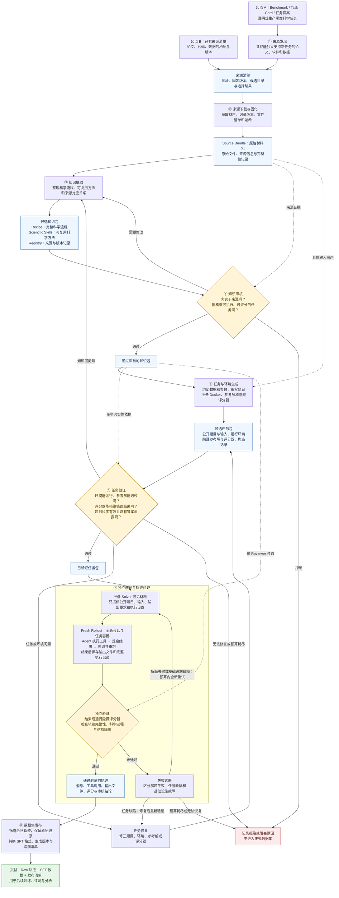
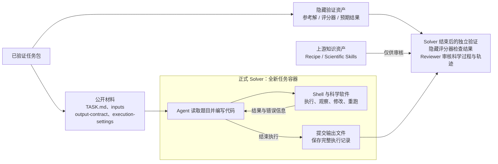

# 科学任务与轨迹数据生产管线

把论文、科学软件和数据转成可执行、可评分的科学任务，让 Agent 独立解题，再把通过验证的完整执行轨迹整理为训练与评测数据。

> 下一版技术选型已确认：Data Designer 组织生成，Gym + Harbor 承接 rollout。本文保留阶段职责总览；组件分工及新版整体流程图、rollout 时序图见[第十三章](design/13-data-designer-gym-harbor-architecture.md)。新版尚待集成验证。

## 1. 整体流程

实线表示生产流程，虚线表示审核证据。正式生产共八个阶段；第七阶段在图中拆开显示解题和轨迹验证，方便理解。

重试遵守预算，每次重新建立会话和工作区。历史失败轨迹、评分器结果和 Reviewer 反馈不会传给下一次 Solver。任务修复后必须重新验证，才能再次解题。

## 2. 每个阶段的输入、工作与输出

| 阶段 | 输入是什么 | 做什么 | 输出是什么 |
| --- | --- | --- | --- |
| ① 来源发现 | Benchmark、Task Card 或任务提案；数量和领域要求 | 理解目标能力，寻找独立科学来源，检查来源质量与重复实体；已有合格清单可跳过检索 | 来源地址与固定版本、`selection.yaml`、候选目录与报告 |
| ② 来源下载与固化 | 来源清单、下载策略 | 获取代码、文档和数据，固定版本并记录文件哈希 | Source Bundle、文件清单与来源记录 |
| ③ 知识抽取 | Source Bundle | 提取科学目标、方法、前提、输入输出和验证线索，拆分完整流程与局部能力 | 候选 Recipe、Scientific Skills、references 和 registry |
| ④ 知识审核 | 候选知识包、原始来源证据 | 分别判断知识是否忠实、是否足以生成任务；给出通过、修改或拒绝结论 | 审核报告、通过审核的知识包，或需要修正的问题 |
| ⑤ 任务与环境生成 | 通过审核的知识包、具体数据、任务要求、可用运行环境 | 绑定具体实例，编写自包含题目与输出要求，准备 Docker 环境、参考解和评分器 | 候选 Task Package、环境与构造记录 |
| ⑥ 任务验证与修复 | 候选任务包、知识依据、验证策略 | 检查环境；在全新工作区执行参考解；用错误结果和有效等价结果检查评分器；审核任务语义与信息隔离；必要时修复并重验 | 已验证任务包与验证证据，或阻塞记录 |
| ⑦ 独立解题与轨迹验证 | 已验证任务的公开材料、运行环境、Solver 配置；验证侧另有知识依据和隐藏评分器 | Solver 在容器内交互解题；结束后独立评分，审核科学过程、执行记录与信息边界 | 完整 attempt、输出文件、评分与审核报告；通过后成为 Verified Trajectory |
| ⑧ 数据集发布 | 通过验证的轨迹、数据集配置 | 检查准入与文件完整性，保留原始轨迹，生成训练格式和 loss mask，冻结版本 | Raw 数据集、SFT 记录、发布清单与哈希 |

Benchmark 的公开题目用于指导来源发现，其答案、隐藏测试、参考解和原始评测实例不能作为新任务的来源材料。

## 3. Solver 能看到什么

**正式 Solver 不接收 Campaign、Recipe、Scientific Skills、参考解或评分器。** Recipe 和 Scientific Skills 用于上游出题及审核。题目必须自包含，不能要求 Solver 去读取这些知识资产。

Solver 可在容器中自行检查结果；隐藏评分器的结果不回传给 Solver，也不会成为下一次尝试的提示。

## 4. 批次配置与全程追溯

- **Campaign Brief：本批次想生产什么。** 描述目标领域、任务分布、调整要求和验收意图，按需传给来源发现、知识抽取、出题及 Reviewer；不传给 Solver。
- **Agent 与运行配置：用什么执行。** 指定各阶段模型、Harness、工具、环境与资源限制。
- **Controller：管理流程。** 负责阶段衔接、准入检查、修复预算、重试和断点续跑。
- **Lineage：记录数据从哪里来。** 串联 Source → Knowledge → Task → Trajectory → Dataset，并保存文件哈希、环境版本、模型配置和审核结论。

数据集发布是这条生产管线的交付终点。SFT 训练、独立评测和收益分析消费这些数据，属于后续工作。

## 5. 详细设计入口

- [完整设计索引](scientific-data-generation-design.md)
- [八阶段生产控制器](design/10-agent-factory-production-pipeline.md)
- [Campaign 与阶段提示词](design/11-campaign-brief-prompt-compilation.md)
- [正式 Solver 容器与执行边界](design/12-interactive-container-rollout.md)
